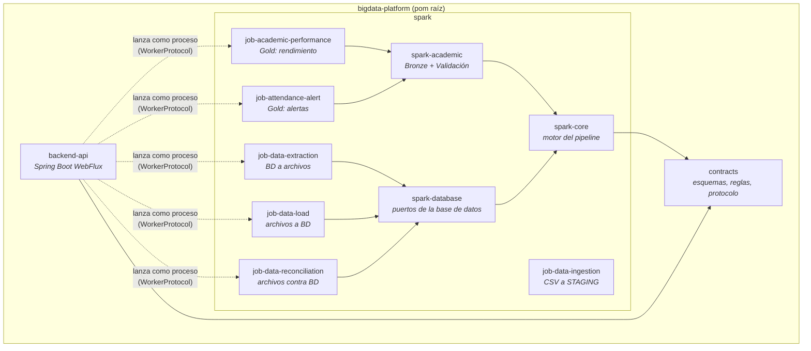
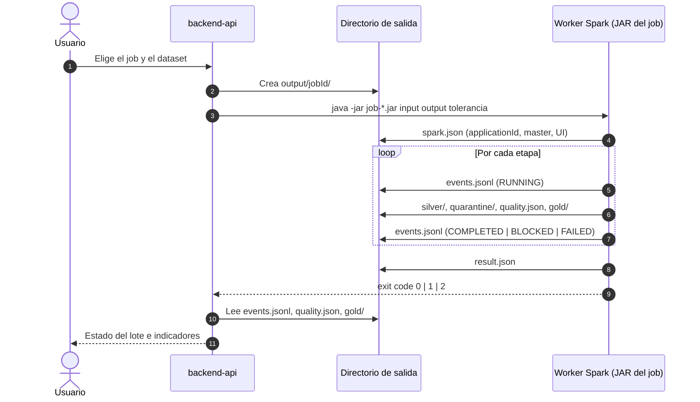
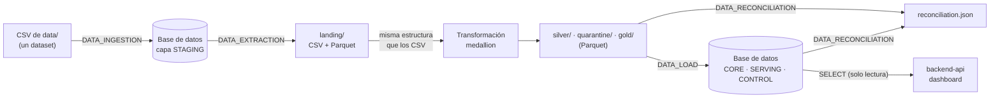
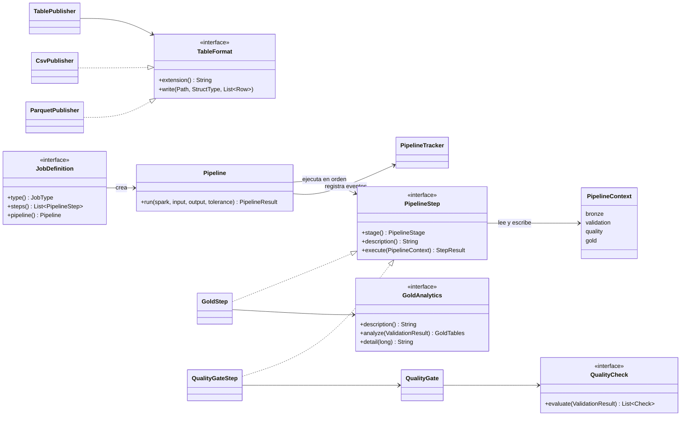
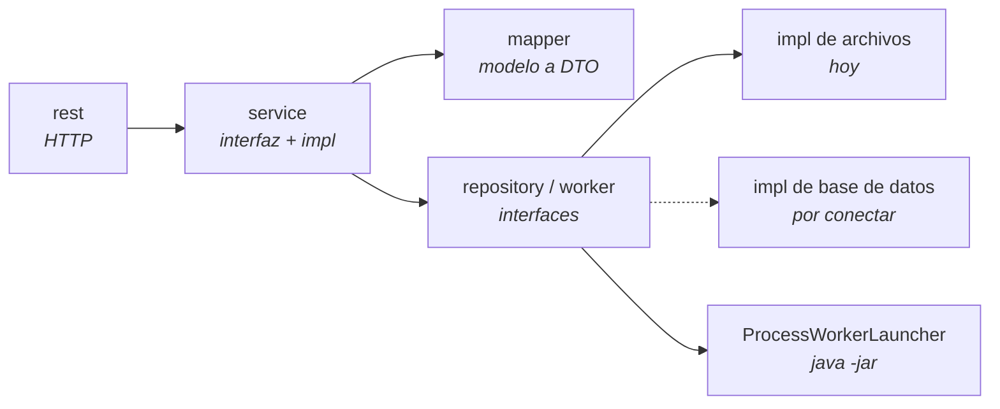
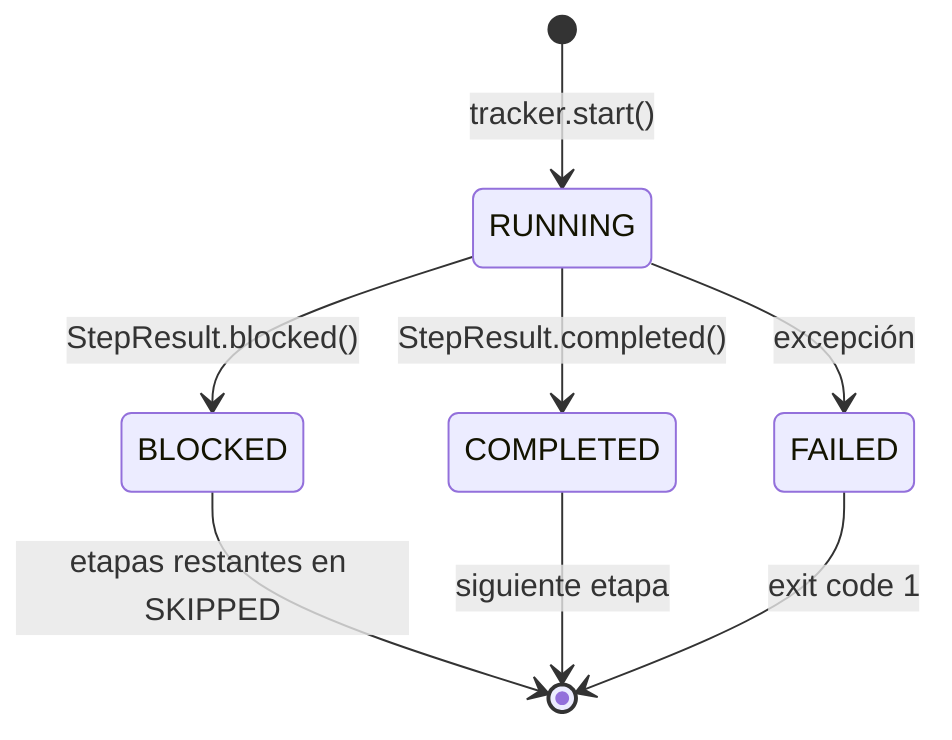
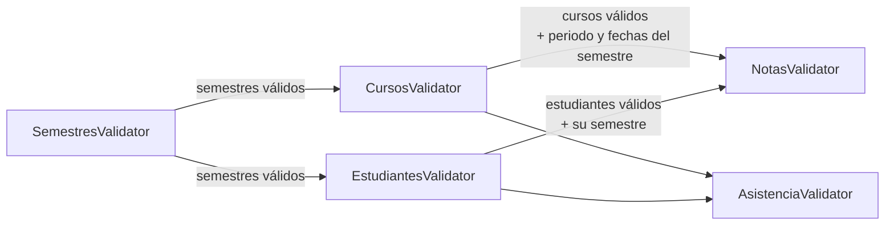
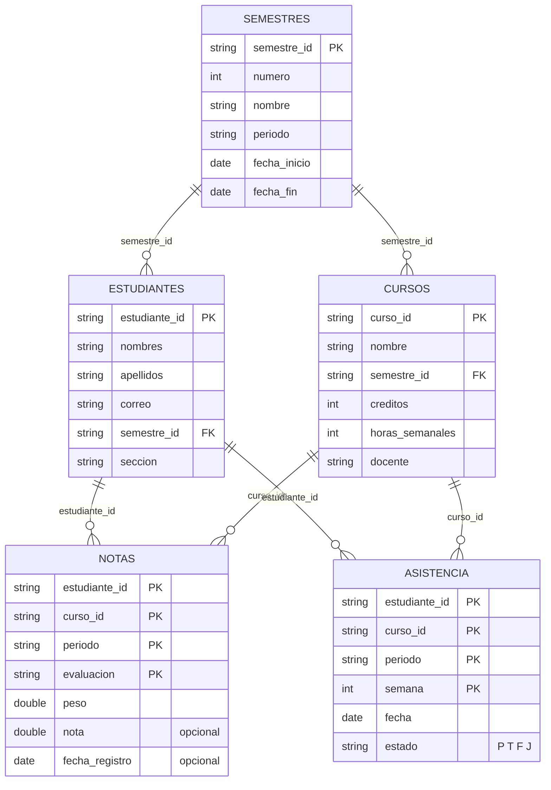

# Vallegrande Big Data Platform - Servicio Spark

Plataforma de procesamiento por lotes que toma los registros académicos de Vallegrande (semestres, cursos, estudiantes, notas y asistencia), los valida con reglas de calidad, separa las filas observadas en cuarentena y publica tablas analíticas listas para consumo: rendimiento académico, resúmenes por curso, sección y estudiante, distribución de notas y alertas de inasistencia.

El procesamiento se implementa con **Apache Spark 4.1** sobre una **arquitectura Medallion** (Bronze, Silver, Gold) con una **puerta de calidad** que decide si el lote puede publicarse.


<p align="center">
  
</p>

---

> **Otros documentos.** [Guía de clase](docs/GUIA-CLASE.md) (por dónde empezar, archivo por archivo) · [Contrato del API para el frontend](docs/API-FRONTEND.md) (JSON de cada endpoint) · [Plan para los 3 proyectos de los estudiantes](docs/GUIA-DOCENTE-CARGA-ORACLE.md).

## Tabla de contenidos

1. [Visión general](#1-visión-general)
2. [Arquitectura](#2-arquitectura)
3. [Estructura del repositorio](#3-estructura-del-repositorio)
4. [Módulos](#4-módulos)
5. [Pipeline Medallion](#5-pipeline-medallion)
6. [Datos de entrada](#6-datos-de-entrada)
7. [Reglas de calidad](#7-reglas-de-calidad)
8. [Puerta de calidad](#8-puerta-de-calidad)
9. [Jobs y tablas Gold](#9-jobs-y-tablas-gold)
10. [Protocolo del worker](#10-protocolo-del-worker)
11. [Configuración](#11-configuración)
12. [Compilación y ejecución](#12-compilación-y-ejecución)
13. [Pruebas](#13-pruebas)
14. [Cómo extender el servicio](#14-cómo-extender-el-servicio)
15. [Decisiones de diseño](#15-decisiones-de-diseño)
16. [Archivos importantes](#16-archivos-importantes)
17. [Solución de problemas](#17-solución-de-problemas)
18. [Estado del proyecto](#18-estado-del-proyecto)
19. [Glosario](#19-glosario)

---

## 1. Visión general

### 1.1 Problema que resuelve

Los registros académicos llegan como archivos CSV exportados de un sistema de notas. Esos archivos pueden traer errores de digitación (notas fuera de escala, fechas inválidas, estados de asistencia desconocidos), registros duplicados o referencias rotas (un estudiante que no existe, un curso de otro semestre). Calcular indicadores directamente sobre esos datos produce reportes incorrectos.

El servicio Spark resuelve esto en un solo lote reproducible:

| Paso | Qué garantiza |
|------|---------------|
| Lectura controlada | Las 5 tablas se leen como texto con su número de fila original, sin perder ningún registro. |
| Validación | Cada fila se evalúa con 15 reglas agrupadas en 5 dimensiones de calidad. |
| Cuarentena | Las filas con problemas no se descartan: se guardan con su tabla, fila, clave, motivos y el registro original. |
| Silver | Las filas válidas se publican tipadas (enteros, decimales, fechas). |
| Puerta de calidad | Si alguna tabla supera la tolerancia de rechazo, el lote se bloquea y no se publica Gold. |
| Gold | Se calculan los indicadores del job (promedios, condición, asistencia, orden de mérito, alertas). |
| Exportación | Todas las tablas se publican en CSV y Parquet con escritura atómica, más un resumen JSON. |

### 1.2 Principios

- **Un pipeline, varios jobs.** Todas las etapas son compartidas; cada job solo aporta su analítica Gold.
- **Nada se pierde en silencio.** `recibidas = aceptadas + rechazadas` se verifica en cada ejecución.
- **Contratos explícitos.** Esquemas, reglas, políticas de calificación y protocolo de comunicación viven en un módulo `contracts` sin dependencias, compartido entre Spark y el backend.
- **Trazabilidad.** Cada etapa emite eventos en `events.jsonl` con duración, filas y número de jobs de Spark ejecutados.

---

## 2. Arquitectura

### 2.1 Vista de módulos



Las flechas sólidas son dependencias Maven. Las flechas punteadas representan la integración en tiempo de ejecución: el backend **no** depende de Spark, solo del módulo `contracts`.

### 2.2 Cómo está pensado el servicio

El servicio Spark se diseñó como un **worker por lotes desacoplado** del backend:

1. El backend recibe qué job ejecutar y con qué dataset (una carpeta de `data/` con los 5 CSV) y crea un directorio de salida por ejecución, nombrado con su identificador.
2. El backend lanza el JAR del job como **proceso independiente** (`java -jar <modulo>.jar <input> <output> <tolerancia>`). Los nombres de módulo, JAR y clase principal salen del enum `JobType`.
3. El worker escribe su progreso en archivos dentro del directorio de salida (`events.jsonl`, `spark.json`, `quality.json`, `result.json`). El backend solo tiene que leer esos archivos para mostrar el avance.
4. Al terminar, el código de salida del proceso indica el resultado: `0` publicado, `1` error, `2` bloqueado por calidad.



> [!IMPORTANT]
> Este diseño de proceso separado aísla la JVM de Spark (memoria, `--add-opens`, dependencias de Hadoop) de la JVM del backend. Un fallo del job nunca tumba el API y cada ejecución deja un rastro completo en disco que puede auditarse después.

### 2.3 Flujo de punta a punta

El siguiente diagrama animado recorre un lote completo: desde que el usuario elige el job y el dataset en el frontend hasta que recibe de vuelta los datos limpios y los indicadores. Se alternan dos ejecuciones para mostrar que el backend elige el job según el `JobType`: la **ejecución A** usa `ACADEMIC_PERFORMANCE` y la **ejecución B** usa `ATTENDANCE_ALERT`. Las etapas del pipeline son las mismas; solo cambia la analítica Gold y las tablas que se publican.

<p align="center">
  
</p>

| Paso | Carril | Qué ocurre | Elementos del código involucrados |
|------|--------|------------|-----------------------------------|
| 1 | Frontend | El usuario selecciona los 5 CSV (`semestres`, `cursos`, `estudiantes`, `notas`, `asistencia`), elige el tipo de análisis y la tolerancia de rechazo, y envía el lote al backend. | `JobType` (opciones disponibles y etiqueta legible con `label()`), `GradingPolicy.DEFAULT_MAX_REJECTED_RATIO` (0.05 como valor sugerido) |
| 2 | Backend API | Recibe los archivos y hace una validación previa barata, sin Spark: que estén las 5 tablas, que las cabeceras coincidan y que no se superen los límites de carga. Si algo falla, responde de inmediato sin lanzar ningún job. | `AcademicSchema.TABLES`, `COLUMNS`, `MAX_ROWS_PER_TABLE` (200 000), `MAX_BYTES_PER_TABLE` (20 MB), `MAX_CELLS_LENGTH` (200) |
| 3 | Backend API | Genera un identificador para el lote y crea el directorio de salida `output/<jobId>/`. | Convención de nombres de `WorkerProtocol` |
| 4 | Backend API | Según el `JobType` elegido, lanza **un** proceso Java independiente con el JAR correspondiente y los argumentos `input output tolerancia`. La salida estándar del proceso se redirige a `worker.log`. | `JobType.jar()`, `JobType.mainClass()`, `WorkerProtocol.LOG_FILE` |
| 5 | Worker Spark | El job ejecuta las 7 etapas del pipeline Medallion. A medida que avanza escribe en disco: `events.jsonl` en cada etapa, `quarantine/` con las filas rechazadas, `silver/` con los datos limpios y tipados, `quality.json` con la decisión de la puerta de calidad, `gold/` con los indicadores (solo si el lote se publica) y por último `result.json`. Termina con el código de salida 0, 1 o 2. | `JobLauncher`, `AcademicSteps.medallion(...)`, `PipelineTracker`, `TablePublisher` |
| 6 | Backend API | Lee la carpeta de salida: `events.jsonl` mientras el job corre (progreso) y `result.json`, `quality.json` y el código de salida al terminar. Expone los archivos de `gold/`, `silver/` y `quarantine/` para consulta y descarga. | `WorkerProtocol` (`EVENTS_FILE`, `QUALITY_FILE`, `RESULT_FILE`, `SUMMARY_FILE`, `GOLD`, `SILVER`, `QUARANTINE`), `StageEvent`, `JobType.goldTables()` |
| 7 | Frontend | Muestra el progreso en vivo: qué etapa se está ejecutando y su estado (`RUNNING`, `COMPLETED`, `BLOCKED`, `SKIPPED`, `FAILED`). | `PipelineStage`, `StageStatus` |
| 8 | Frontend | Al terminar, presenta el resultado: indicadores de `gold/resumen.json`, tablas Gold, reporte de calidad y descarga de los datos limpios (`silver/`) y de los rechazados (`quarantine/`) para corregirlos. | `QualityRule` (descripción legible de cada motivo de rechazo) |

Cómo vuelve a salir la data limpia, según el resultado del lote:

| Resultado | Código de salida | Qué recibe el frontend |
|-----------|------------------|------------------------|
| Publicado | `0` | Tablas Gold del job y `resumen.json`, datos limpios de `silver/`, filas rechazadas de `quarantine/` y el reporte `quality.json`. |
| Bloqueado por calidad | `2` | Sin tablas Gold. Recibe `quality.json` con los chequeos que fallaron, `quarantine/rechazados` para corregir los datos y `silver/` para inspección. El usuario corrige y vuelve a enviar el lote. |
| Error | `1` | Mensaje de error desde `worker.log`; en `events.jsonl` la etapa que falló aparece como `FAILED`. |

> [!NOTE]
> El frontend y la lógica de orquestación del backend todavía no existen en este repositorio (ver [sección 18](#18-estado-del-proyecto)). Los pasos 1 a 4 y 6 a 8 describen el flujo **previsto**, construido sobre los contratos que ya están en `contracts`. El paso 5 está implementado y probado.

> [!TIP]
> El backend no necesita conocer Spark para seguir el progreso: basta con leer `events.jsonl` línea por línea. Cada línea es un `StageEvent` completo, por lo que puede reenviarse tal cual al frontend, por ejemplo mediante Server-Sent Events con WebFlux.

### 2.4 Stack tecnológico

| Componente | Versión | Uso |
|------------|---------|-----|
| Java | 17 | Lenguaje y runtime (`maven.compiler.release=17`) |
| Apache Spark SQL | 4.1.2 (Scala 2.13) | Motor de procesamiento distribuido |
| Apache Parquet | incluido en Spark | Escritura de archivos columnares |
| Jackson YAML | 2.21.2 | Lectura de `application.yaml` y escritura de JSON |
| Apache Commons CSV | 1.14.1 | Escritura de CSV de salida |
| JUnit Jupiter | 5.12.2 | Pruebas de integración de los jobs |
| Spring Boot | 3.5.16 | `backend-api` (WebFlux, Validation, Actuator) |
| Reactor Test, WebTestClient, Awaitility | de Spring Boot | Pruebas del backend |
| Maven Wrapper | 3.9.16 | Construcción reproducible sin instalar Maven |

### 2.5 Familias de jobs y flujo con la base de datos

Los jobs se agrupan en cinco **familias** (`JobKind`). Cada familia tiene su propia entrada y sus propias etapas, pero todas usan el mismo motor de pipeline y el mismo protocolo del worker.

| Familia | Jobs | Entrada (`JobInput`) | Etapas | Salida |
|---------|------|----------------------|--------|--------|
| `TRANSFORMATION` | `ACADEMIC_PERFORMANCE`, `ATTENDANCE_ALERT` | Los 5 CSV | `BRONZE` a `EXPORT` (medallion) | `silver/`, `quarantine/`, `gold/` |
| `INGESTION` | `DATA_INGESTION` | Un dataset (los 5 CSV de una carpeta de `data/`) | `INGEST` | Tablas `STG_*` en la base de datos |
| `EXTRACTION` | `DATA_EXTRACTION` | Ninguna: lee de la base de datos | `EXTRACT` | `landing/` (CSV y Parquet) |
| `LOAD` | `DATA_LOAD` | Carpeta de una transformación publicada | `LOAD_CORE`, `LOAD_SERVING` | Tablas en la base de datos |
| `RECONCILIATION` | `DATA_RECONCILIATION` | Carpeta de una transformación publicada | `RECONCILE` | `reconciliation.json` |

Los jobs actuales **no cambian**: la transformación sigue siendo el medallion de siempre y los jobs nuevos se agregan a su alrededor.



El flujo de punta a punta es: **ingestar, extraer, transformar, cargar, conciliar**. El dashboard lee siempre de las tablas `SERVING_*` de la base de datos, del último lote cargado; el backend nunca escribe en la base.

La **capa de base de datos** (`DatabaseLayer`) es el acuerdo entre Spark y el backend sobre dónde vive cada tabla:

| Capa | Prefijo | Contenido | Estrategia de escritura |
|------|---------|-----------|-------------------------|
| `STAGING` | `STG_` | Datos crudos tal como llegaron | Origen del job de extracción |
| `CORE` | `CORE_` | Silver: datos limpios | `MERGE` por la clave natural de `AcademicSchema.KEYS` (maestras primero) |
| `SERVING` | `SERVING_` | Gold: lo que consume el dashboard | `REPLACE_BATCH`: cada fila lleva `batch_id` y repetir la carga no duplica |
| `CONTROL` | `ETL_` | Cuarentena y control de ejecuciones | `REPLACE_BATCH` |

> [!IMPORTANT]
> Los jobs se conectan a **Oracle** (`OracleDatabase`), configurado por defecto para un Oracle local. Se probó contra H2 en modo Oracle, **no contra un Oracle real**. Detalle, `docker-compose` y lo que sigue pendiente en la [sección 11.6](#116-conexión-a-oracle).

---

## 3. Estructura del repositorio

```text
00_IsaelFatama-Bigdata-Spark/
├── CHANGELOG.md                    # Historial de versiones
├── pom.xml                         # POM raíz: versiones, módulos y opciones JVM de Spark
├── mvnw / mvnw.cmd                 # Maven Wrapper
├── contracts/                      # Contratos compartidos (sin dependencias)
│   └── src/main/java/.../contracts/
│       ├── AcademicSchema.java     # Tablas, columnas, claves, columnas opcionales, límites
│       ├── GradingPolicy.java      # Nota aprobatoria, umbrales de inasistencia, condiciones
│       ├── DatabaseLayer.java      # Capas de la base de datos: STAGING, CORE, SERVING, CONTROL
│       ├── JobInput.java           # Entrada que necesita un job: CSV, nada o una ejecución previa
│       ├── JobKind.java            # Familia del job: transformación, extracción, carga, conciliación
│       ├── JobType.java            # Catálogo de jobs: módulo, JAR, clase principal, familia, tablas Gold
│       ├── PipelineStage.java      # BRONZE ... EXPORT, EXTRACT, LOAD_CORE, LOAD_SERVING, RECONCILE
│       ├── QualityRule.java        # 15 reglas con dimensión y descripción
│       ├── StageEvent.java         # Evento de etapa escrito en events.jsonl
│       ├── StageStatus.java        # RUNNING, COMPLETED, BLOCKED, SKIPPED, FAILED
│       └── WorkerProtocol.java     # Exit codes y nombres de archivos/carpetas de salida
├── spark/
│   ├── pom.xml                     # Agregador Spark: dependencias, manifest y copia de lib/
│   ├── spark-core/                 # Motor genérico del pipeline
│   │   └── src/main/
│   │       ├── java/.../spark/core/
│   │       │   ├── config/         # SparkSessionFactory, WorkerConfig, PermissiveLocalFileSystem
│   │       │   ├── launcher/       # JobDefinition, JobLauncher (main común)
│   │       │   ├── layer/          # BronzeTables, ValidationResult, GoldTables
│   │       │   ├── pipeline/       # Pipeline, PipelineContext, PipelineStep, PipelineTracker...
│   │       │   ├── publication/    # TablePublisher, CsvPublisher, ParquetPublisher, JsonPublisher
│   │       │   ├── quality/        # QualityGate, QualityCheck, QualityReport
│   │       │   └── step/           # QuarantineStep, SilverStep, QualityGateStep, GoldStep, ExportStep
│   │       └── resources/
│   │           ├── application.yaml
│   │           └── log4j2.properties
│   ├── spark-academic/            # Dominio académico: extracción y validación
│   │   └── src/main/java/.../spark/academic/
│   │       ├── AcademicSteps.java  # Ensambla las 7 etapas para cualquier job académico
│   │       ├── extraction/         # CsvExtractor
│   │       ├── quality/            # MasterTablesCheck
│   │       ├── step/               # BronzeStep, ValidationStep
│   │       └── validation/         # Un validador por tabla + ValidationRules + ReferenceData
│   ├── spark-database/             # Puertos de la base de datos y el adaptador de Oracle
│   │   └── src/main/java/.../spark/database/
│   │       ├── Database.java           # La interfaz: read() y write()
│   │       ├── oracle/                 # OracleDatabase (lectura y escritura) y SqlStatements (el SQL como constantes)
│   │       ├── SchemaInstaller.java    # Ejecuta los scripts de db/oracle/ (crea las tablas)
│   │       ├── seed/StagingSeeder.java # Carga un lote de CSV en las tablas STG_* para pruebas locales
│   │       ├── TableRef.java / WriteMode.java
│   │       ├── DatabaseConfig.java     # DB_URL, DB_USER, DB_PASSWORD, DB_SCHEMA (variables de entorno)
│   │       ├── DatabaseNaming.java     # minúsculas del lago a MAYÚSCULAS de la base y viceversa
│   │       └── RunOutputs.java         # lectura de la carpeta de salida de una ejecución
│   ├── job-academic-performance/  # Job: rendimiento académico (7 tablas Gold)
│   ├── job-attendance-alert/      # Job: alertas de inasistencia (2 tablas Gold)
│   ├── job-data-ingestion/              # Job: CSV a la capa STAGING de la base de datos
│   ├── job-data-extraction/             # Job: base de datos a archivos (landing/)
│   ├── job-data-load/                  # Job: archivos a base de datos (CORE y SERVING)
│   └── job-data-reconciliation/           # Job: archivos contra base de datos
├── backend-api/                    # API Spring Boot WebFlux, MVC en capas (rest, service, repository)
│   └── src/main/java/.../bigdata/api/
│       ├── config/                 # Propiedades (workspace, worker, CORS), reloj y filtro CORS
│       ├── rest/                   # Controladores HTTP: JobRest, ExecutionRest, DashboardRest
│       ├── dto/                    # request/ (CreateExecutionRequest, PageQuery) y response/
│       ├── service/ y service/impl/        # Interfaces de los casos de uso y sus implementaciones
│       ├── repository/ y repository/impl/  # Interfaces de acceso a datos; impl/ con los de archivos y los de BD
│       ├── model/                  # Modelo de dominio inmutable: Execution, ExecutionStatus
│       ├── mapper/                 # Conversión de modelo a DTO
│       ├── component/              # Cola de ejecuciones, recuperación, validador de CSV, rutas seguras
│       ├── worker/ y worker/impl/  # Lanzamiento del worker como proceso
│       └── exception/              # Excepciones del dominio y GlobalExceptionHandler
├── data/
│   ├── limpio/                     # Lote de referencia sin errores
│   └── con-errores/                # Mismo lote con errores inyectados
└── docs/assets/
    ├── pipeline-medallion.svg      # Diagrama animado del pipeline
    └── flujo-end-to-end.svg        # Diagrama animado frontend -> backend -> Spark -> resultados
```

---

## 4. Módulos

### 4.1 `contracts`

Módulo Java puro (sin dependencias) que define el **lenguaje común** entre el worker Spark y el backend. Cualquier cambio aquí afecta a ambos lados, por eso concentra todo lo que debe coincidir entre procesos.

| Clase | Responsabilidad |
|-------|-----------------|
| `AcademicSchema` | Nombres de las 5 tablas, orden de columnas, clave natural de cada tabla, columnas opcionales (`notas.nota`, `notas.fecha_registro`), estados de asistencia válidos (`P`, `T`, `F`, `J`), límites de carga y versión de reglas (`2.0.0`). |
| `GradingPolicy` | Escala 0 a 20, nota aprobatoria 13, inasistencia máxima 30 %, umbral de riesgo 20 %, tolerancia por defecto 5 % y las etiquetas de condición (`APROBADO`, `DESAPROBADO`, `INHABILITADO`, `PENDIENTE`, `EN_RIESGO`, `NORMAL`). |
| `JobType` | Catálogo de jobs disponibles. Cada entrada define módulo, JAR, clase `main`, etiqueta legible, familia (`JobKind`) y lista de tablas Gold que produce. `JobType.DEFAULT = ACADEMIC_PERFORMANCE`. |
| `JobKind` | Familia del job (`TRANSFORMATION`, `EXTRACTION`, `LOAD`, `RECONCILIATION`), la entrada que necesita (`JobInput`) y su tolerancia por defecto (0,05 para transformación y 0 para el resto). |
| `JobInput` | Qué entrada necesita un job: `CSV_FILES`, `DATASET`, `NONE` o `PREVIOUS_EXECUTION`. El backend valida las peticiones con este dato, sin conocer cada job. |
| `DatabaseLayer` | Capas lógicas de la base de datos (`STAGING`, `CORE`, `SERVING`, `CONTROL`), su prefijo de tabla y la columna `batch_id`. |
| `PipelineStage` | Las 7 etapas del medallion en orden (`BRONZE`, `VALIDATION`, `QUARANTINE`, `SILVER`, `QUALITY_GATE`, `GOLD`, `EXPORT`) y las de las otras familias: `EXTRACT`, `LOAD_CORE`, `LOAD_SERVING`, `RECONCILE`. |
| `StageStatus` | Estados de una etapa: `RUNNING`, `COMPLETED`, `BLOCKED`, `SKIPPED`, `FAILED`. |
| `StageEvent` | Registro que se serializa como una línea de `events.jsonl`. |
| `QualityRule` | Las 15 reglas de calidad, cada una con su dimensión y descripción. |
| `WorkerProtocol` | Códigos de salida y nombres de archivos y carpetas que el worker produce (incluye `landing/`, `reconciliation.json` y el `execution.json` que guarda el backend). |

### 4.2 `spark/spark-core`

Motor **genérico** del pipeline. No conoce el dominio académico: solo sabe ejecutar una lista de etapas, registrar eventos, evaluar calidad y publicar tablas.

| Paquete | Clases clave | Qué hace |
|---------|--------------|----------|
| `config` | `WorkerConfig`, `SparkSessionFactory`, `PermissiveLocalFileSystem` | Lee `application.yaml`, crea la `SparkSession` con la configuración del worker, escribe `spark.json` y, en Windows sin Hadoop, reemplaza el sistema de archivos local para evitar `winutils.exe`. |
| `launcher` | `JobDefinition`, `JobLauncher` | `JobDefinition` es la interfaz que implementa cada job (`type()` y `steps()`). `JobLauncher` es el `main` común: valida argumentos, ejecuta el pipeline, escribe `result.json` y termina con el código de salida correcto. |
| `pipeline` | `Pipeline`, `PipelineStep`, `PipelineContext`, `PipelineTracker`, `StepResult`, `PipelineResult` | Orquesta las etapas en orden, comparte estado entre ellas mediante el contexto, detiene el pipeline si una etapa devuelve `blocked`, marca las restantes como `SKIPPED` y libera los `Dataset` cacheados al final. Los jobs que no pasan por la validación del medallion informan sus conteos con `PipelineContext.counts(procesadas, diferencias)`, que alimentan `received` y `rejected` de `result.json`. |
| `layer` | `BronzeTables`, `ValidationResult`, `GoldTables` | Representan el estado de cada capa. `ValidationResult` calcula conteos por tabla y por motivo de rechazo. |
| `quality` | `QualityGate`, `QualityCheck`, `QualityReport` | Evalúa la tolerancia por tabla, los chequeos adicionales y la conservación de filas, y produce el reporte `quality.json`. |
| `step` | `QuarantineStep`, `SilverStep`, `QualityGateStep`, `GoldStep`, `ExportStep`, `GoldAnalytics` | Etapas reutilizables. `GoldAnalytics` es el punto de extensión que cada job implementa. |
| `publication` | `TablePublisher`, `TableFormat`, `CsvPublisher`, `ParquetPublisher`, `JsonPublisher`, `AtomicFiles` | Escritura de tablas a CSV y Parquet y de documentos JSON, siempre mediante archivo temporal y movimiento atómico. |



### 4.3 `spark/spark-academic`

Capa de **dominio académico** compartida por todos los jobs. Implementa las etapas que dependen del esquema académico.

| Clase | Qué hace |
|-------|----------|
| `AcademicSteps.medallion(GoldAnalytics)` | Ensambla las 7 etapas en el orden correcto. Un job solo tiene que pasar su analítica Gold. |
| `AcademicSteps.qualityGate()` | Crea la puerta de calidad con la versión de reglas `2.0.0` y el chequeo `MasterTablesCheck`. |
| `extraction.CsvExtractor` | Lee las 5 tablas CSV con esquema de texto, recorta espacios, convierte vacíos en `null`, agrega la columna `fila` y cachea cada tabla. |
| `step.BronzeStep` | Etapa `BRONZE`: invoca al extractor y guarda `BronzeTables` en el contexto. |
| `step.ValidationStep` | Etapa `VALIDATION`: invoca a `AcademicValidator` y guarda `ValidationResult` en el contexto. |
| `validation.AcademicValidator` | Ejecuta los validadores en orden de dependencia y arma las tablas Silver y la tabla de rechazados. |
| `validation.*Validator` | Un validador por tabla (`Semestres`, `Cursos`, `Estudiantes`, `Notas`, `Asistencia`). Tipan columnas con `try_cast` y aplican las reglas propias de la tabla. |
| `validation.ValidationRules` | Reglas comunes: campo requerido, detección de duplicados, filtro de válidas y armado de la fila de cuarentena. |
| `validation.ReferenceData` | Tablas de referencia ya validadas (semestres, cursos, estudiantes) que se usan para las reglas de integridad y consistencia. |
| `quality.MasterTablesCheck` | Exige que `semestres`, `cursos` y `estudiantes` tengan al menos una fila válida. |

### 4.4 `spark/job-academic-performance`

Job principal (`JobType.ACADEMIC_PERFORMANCE`). Clase `main`: `pe.edu.vallegrande.bigdata.job.performance.AcademicPerformanceJob`. Su analítica (`AcademicAnalytics`) se compone de un constructor de tabla por cada salida (`PerformanceBuilder`, `CourseSummaryBuilder`, `StudentSummaryBuilder`, `SectionSummaryBuilder`, `AssessmentSummaryBuilder`, `GradeDistributionBuilder`, `WeeklyAttendanceBuilder`, `SummaryBuilder`). Detalle en la [sección 9.1](#91-job-academic-performance).

### 4.5 `spark/job-attendance-alert`

Job de alertas tempranas (`JobType.ATTENDANCE_ALERT`). Clase `main`: `pe.edu.vallegrande.bigdata.job.attendance.AttendanceAlertJob`. Su analítica (`AttendanceAlertAnalytics`) clasifica cada matrícula según su porcentaje de faltas. Detalle en la [sección 9.2](#92-job-attendance-alert).

### 4.6 `spark/spark-database`

Contiene **todo lo relacionado con la base de datos**: los puertos que usan los jobs nuevos y el adaptador de Oracle que los implementa. Los jobs dependen de los puertos, no de Oracle, así que otro motor se agrega con un adaptador nuevo. Depende de `spark-core`.

| Clase | Qué hace |
|-------|----------|
| `Database` | La interfaz que usan los jobs: `read(spark, tabla)` y `write(datos, tabla, modo, loteId)`. Otro motor es otra implementación. |
| `oracle.OracleDatabase` | Implementación de Oracle sobre JDBC. `fromEnvironment()` falla con un mensaje claro si falta `DB_PASSWORD`. **No crea tablas**: escribe en las tablas que ya existen, pasando por su tabla `_LOAD`, y aplica el cambio en una sola transacción. |
| `oracle.SqlStatements` | El SQL como constantes (`MERGE`, borrado e inserción por lote) con el lote siempre como parámetro. Se prueba sin base de datos. |
| `SchemaInstaller` | Ejecuta los scripts de `spark-database/src/main/resources/db/oracle/` (`01_staging.sql`, `02_core.sql`, `03_serving.sql`, `04_control.sql`). Se puede ejecutar más de una vez. |
| `DatabaseTables` | Qué tablas gold se publican en `SERVING` (las del dashboard, tomadas de `JobType`) y dónde están los scripts. |
| `seed.StagingSeeder` | Carga un lote de CSV en las tablas `STG_*` (reemplaza su contenido) para preparar una base local. |
| `TableRef` | Referencia lógica a una tabla: capa, nombre del lago (minúsculas) y clave natural. |
| `WriteMode` | `MERGE` (inserta y actualiza por clave) y `REPLACE_BATCH` (borra e inserta el lote en una transacción). Ambos deben ser idempotentes. |
| `DatabaseConfig` | Lee `DB_URL`, `DB_USER`, `DB_PASSWORD` y `DB_SCHEMA` del entorno. Su `toString()` nunca muestra la contraseña. |
| `DatabaseNaming` | Traduce `estudiante_id` a `ESTUDIANTE_ID` y `notas` a `CORE_NOTAS`, y rechaza nombres que necesitarían comillas. Spark entrecomilla los nombres al escribir por JDBC: una columna en minúscula quedaría sensible a mayúsculas y las consultas sin comillas dejarían de encontrarla. |
| `RunOutputs` | Lee la carpeta de salida de una ejecución anterior. El nombre de esa carpeta es el identificador del lote. |

### 4.7 `spark/job-data-ingestion`

`JobType.DATA_INGESTION`. Recibe un dataset (la carpeta con los 5 CSV), valida los encabezados y los carga como **texto crudo** en las tablas `STG_*` (reemplaza su contenido). Reutiliza `StagingSeeder`. Falla con un mensaje claro si las tablas no existen (hay que ejecutar `SchemaInstaller`) o si falta `DB_PASSWORD`.

### 4.7.1 `spark/job-data-extraction`

`JobType.DATA_EXTRACTION`. Lee las cinco tablas de la capa `STAGING` y las publica en `landing/`. Esa carpeta tiene el mismo formato que la entrada CSV del medallion, así que puede usarse directamente como entrada de una transformación. Si a una tabla de la base le falta una columna del contrato falla indicando cuál. Detalle en la [sección 9.3](#93-job-data-extraction).

### 4.8 `spark/job-data-load`

`JobType.DATA_LOAD`. Toma la carpeta de una transformación publicada y la carga en la base de datos en dos etapas: `LOAD_CORE` (silver por clave natural, maestras primero, y la cuarentena en `CONTROL`) y `LOAD_SERVING` (cada tabla gold con su `batch_id`). Si la ejecución de origen no publicó Gold, no carga nada y termina con código 2. Detalle en la [sección 9.4](#94-job-data-load).

### 4.9 `spark/job-data-reconciliation`

`JobType.DATA_RECONCILIATION`. Verifica que no se perdió ni se duplicó nada entre los archivos de una ejecución y la base de datos. Detalle en la [sección 9.5](#95-job-data-reconciliation).

### 4.10 `backend-api`

Aplicación Spring Boot **WebFlux** que depende únicamente de `contracts`. Lanza los workers según `JobType`, encola las ejecuciones y expone su avance, sus resultados y los endpoints del dashboard.

Sigue una arquitectura **MVC en capas**: la capa `rest` solo traduce HTTP, el servicio aplica las reglas y el acceso a archivos, procesos y base de datos está detrás de interfaces (`repository`, `worker`) con una implementación aparte (`impl`).



| Capa | Paquete | Responsabilidad |
|------|---------|-----------------|
| REST | `rest` | `JobRest`, `ExecutionRest`, `DashboardRest` y `DatasetRest`: traducen HTTP a llamadas de servicio y devuelven `Mono`/`Flux`. No contienen reglas. |
| DTO | `dto.request`, `dto.response` | Lo que entra (`CreateExecutionRequest`, `PageQuery`) y lo que sale (`ExecutionResponse`, `ExecutionDetailResponse`, `JobResponse`, `DashboardResponse`, `PageResponse`). Todos `record` inmutables. |
| Servicio | `service`, `service.impl` | Interfaces (`JobService`, `ExecutionService`, `ExecutionResultService`, `DashboardService`) y sus implementaciones `*Impl`, donde viven las reglas. |
| Repositorio | `repository`, `repository.impl` | Interfaces (`ExecutionRepository`, `ExecutionOutputRepository`, `GoldTableRepository`) e implementaciones `File*`, que leen y escriben archivos. Todo trabajo bloqueante se mueve a `boundedElastic`. |
| Modelo | `model` | `Execution` (inmutable, con `@Builder(toBuilder = true)` de Lombok) y `ExecutionStatus`. |
| Mapper | `mapper` | `ExecutionMapper` y `JobMapper`: convierten el modelo en DTO. |
| Componentes | `component` | `ExecutionRunner` (cola de ejecuciones), `ExecutionRecovery`, `ExecutionFinder` y `ExecutionWorkspace` (rutas seguras: valida el identificador de la ejecución y el nombre del dataset antes de convertirlos en rutas). |
| Worker | `worker`, `worker.impl` | `WorkerLauncher` y `ProcessWorkerLauncher`, que lanza el worker como proceso. |
| Configuración | `config` | `WorkerProperties`, `WorkspaceProperties`, `CorsProperties`, `CorsConfig` y `ClockConfig`. |
| Excepciones | `exception` | Excepciones propias y `GlobalExceptionHandler`: el único lugar donde una excepción se convierte en código HTTP, con el formato `ProblemDetail`. |

**Convenciones del backend.** Lombok (`@RequiredArgsConstructor` para la inyección por constructor, `@Slf4j`, `@Builder`); el `Clock` se inyecta en lugar de llamar a `Instant.now()` para poder fijar la hora en las pruebas; el código no lleva comentarios, los nombres explican la intención.

#### Endpoints

| Método y ruta | Qué hace |
|---------------|----------|
| `GET /api/jobs` y `GET /api/jobs/{tipo}` | Catálogo: familia, entrada que necesita, tolerancia por defecto y tablas Gold. Acepta el tipo sin importar mayúsculas ni guiones. |
| `POST /api/executions` | Lanza un job (cuerpo JSON, ver abajo). Responde `202` con `Location`. |
| `GET /api/datasets` | Carpetas de `data/` que traen los 5 CSV y se pueden elegir como entrada. |
| `GET /api/executions?jobType=&status=` | Lista de la más reciente a la más antigua. |
| `GET /api/executions/{id}` | Estado de la ejecución y su `result.json` cuando existe. |
| `GET /api/executions/{id}/events` | Avance por etapa (`events.jsonl`). |
| `GET /api/executions/{id}/quality` | Reporte de la puerta de calidad (`quality.json`). |
| `GET /api/executions/{id}/reconciliation` | Resultado de una conciliación. |
| `GET /api/executions/{id}/rejected?page=&size=` | Filas en cuarentena, paginadas. |
| `GET /api/executions/{id}/gold/summary` y `.../gold/{table}?page=&size=` | Gold de una ejecución publicada. |
| `GET /api/dashboard/{jobType}/tables` | Tablas que ofrece el job. |
| `GET /api/dashboard/{jobType}/summary` y `.../tables/{table}?page=&size=` | Datos del **último lote cargado en la base de datos** (`SERVING_*`), con su `executionId` y la fecha de carga. Solo lectura. |
| `GET /actuator/health` | Salud del servicio. |

**Qué lleva el cuerpo JSON de `POST /api/executions`** depende de la familia del job (`JobInput`); `threshold` es opcional en todos:

| Familia | Campos |
|---------|--------|
| `TRANSFORMATION` | `jobType` y **uno** de estos: `dataset` (nombre de una carpeta de `data/` con los 5 CSV, por ejemplo `limpio`) o `sourceExecutionId` (una **extracción publicada**, cuyo `landing/` se usa como entrada) |
| `EXTRACTION` | `jobType` |
| `LOAD` y `RECONCILIATION` | `jobType` y `sourceExecutionId`: una transformación que terminó en `PUBLISHED` |

El backend **no recibe archivos ni escribe en la base de datos**: los datos entran por la base (`StagingSeeder`, extracción y carga) o por una carpeta de `data/`, y el backend solo elige qué job lanzar y sirve la salida.

#### Estados de una ejecución

`PENDING` (en la cola) → `RUNNING` (con un worker) → `PUBLISHED` (código 0), `BLOCKED` (código 2) o `FAILED` (cualquier otro). En `FAILED` y `BLOCKED`, el campo `message` trae el detalle de la etapa que falló o bloqueó el lote (tomado de `events.jsonl`), para no tener que abrir `worker.log`. Como máximo `bigdata.worker.max-concurrent` ejecuciones corren a la vez; las demás esperan en `PENDING`. Si el backend se reinicia, las que estaban `PENDING` o `RUNNING` se marcan `FAILED`, porque sus workers ya no están bajo su control.

#### Reglas que aplica el backend

- Los datasets se buscan en `bigdata.workspace.datasets-directory` (por defecto `data`). Un dataset debe traer los 5 CSV; si no, la petición se rechaza diciendo cuáles faltan. Spark valida el contenido y manda lo incorrecto a cuarentena.
- Un CSV no tiene tipos, así que al servir tablas desde archivos los enteros y decimales simples se devuelven como **números**, `true` y `false` como **booleanos** y todo lo demás como texto; los códigos con ceros a la izquierda (`00018310`) y los de formato mixto (`2026-II`) se conservan intactos, y una celda vacía es `null`. Con la base de datos conectada los tipos vienen de la propia base.
- Comprueba que el módulo del worker esté compilado y, si no, responde `503` con el comando para compilarlo.
- Los nombres de tabla y de ejecución se validan contra listas blancas y patrones: no se puede salir de la carpeta de trabajo.
- El `Exception` genérico se registra completo pero al cliente solo se le responde "error interno".

> [!NOTE]
> Los jobs de extracción, carga y conciliación necesitan Oracle y `DB_PASSWORD` (sección 11.6). El resto del backend funciona sin ellos.

---

## 5. Pipeline Medallion

### 5.1 Resumen de etapas

Cuando la publicación en S3 está habilitada, las salidas persistidas de cada etapa siguen los prefijos numerados del estándar de carpetas:

| # | Etapa | Clase | Módulo | Entrada | Salida | Puede bloquear |
|---|-------|-------|--------|---------|--------|----------------|
| 1 | `BRONZE` | `BronzeStep` | spark-academic | `<input>/*.csv` | `BronzeTables` en memoria; CSV originales en `01-bronze/` | No |
| 2 | `VALIDATION` | `ValidationStep` | spark-academic | `BronzeTables` | `ValidationResult`; `02-validation/validation.json` | No |
| 3 | `QUARANTINE` | `QuarantineStep` | spark-core | Filas rechazadas | `03-quarantine/rechazados.{csv,parquet}` | No |
| 4 | `SILVER` | `SilverStep` | spark-core | Filas válidas tipadas | `04-silver/<tabla>.{csv,parquet}` | No |
| 5 | `QUALITY_GATE` | `QualityGateStep` | spark-core | `ValidationResult` + tolerancia | `05-quality-gate/quality.json` | **Sí** |
| 6 | `GOLD` | `GoldStep` | spark-core + job | Tablas Silver | `GoldTables` en memoria; `06-gold/<tabla>.{csv,parquet}` y `resumen.json` si se publica | No |
| 7 | `EXPORT` | `ExportStep` | spark-core | `GoldTables` | `07-export/manifest.json` (índice de artefactos y etapas) | No |

Cada carpeta numerada incluye además `stage.json` con el estado y las métricas de la etapa. La estructura completa, incluida `metadata/`, se muestra en [Publicación opcional en Amazon S3](#125-publicación-opcional-en-amazon-s3).

> [!IMPORTANT]
> Cuarentena y Silver se publican **antes** de la puerta de calidad. Aunque el lote quede bloqueado, siempre quedan disponibles los rechazados (para corregirlos) y las filas válidas (para inspección). Lo único que la puerta impide es publicar indicadores Gold sobre un lote de mala calidad.

### 5.2 Ciclo de vida de una etapa



Cada transición se escribe como una línea JSON en `events.jsonl`. Al iniciar una etapa, `PipelineTracker` abre un *job group* de Spark con el nombre de la etapa; al cerrarla cuenta cuántos jobs de Spark se ejecutaron dentro de ese grupo (`sparkJobs`). Esto permite relacionar cada etapa con lo que se ve en la Spark UI.

### 5.3 BRONZE: lectura de los CSV

Implementada por `CsvExtractor`:

1. Verifica que existan los 5 archivos: `semestres.csv`, `cursos.csv`, `estudiantes.csv`, `notas.csv`, `asistencia.csv`. Si falta uno, lanza `IllegalArgumentException` y el job termina con código `1`.
2. Lee cada archivo con un esquema explícito **todo en texto** (`StringType`), cabecera activa, codificación UTF-8 y modo `PERMISSIVE`.
3. Aplica `nullif(trim(columna), '')` a todas las columnas: los espacios sobrantes se eliminan y las celdas vacías pasan a `null`.
4. Agrega la columna `fila`, que corresponde al **número de línea en el archivo original** (la cabecera es la línea 1, el primer registro la línea 2).
5. Cachea la tabla y cuenta sus filas.

> [!TIP]
> Leer todo como texto es intencional: si Spark infiriera tipos, una nota como `"quince"` se convertiría en `null` sin dejar rastro. Al tipar después con `try_cast`, el pipeline puede distinguir "celda vacía" de "valor inválido" y reportar la regla exacta.

### 5.4 VALIDATION: reglas de calidad

Implementada por `AcademicValidator`. Los validadores se ejecutan en **orden de dependencia** porque las tablas de hechos se validan contra las tablas maestras ya depuradas:



Para cada tabla, el validador:

1. Convierte las columnas numéricas y de fecha con `try_cast` en columnas auxiliares (`_nota`, `_peso`, `_fecha`, etc.).
2. Une la tabla con las referencias necesarias (`ReferenceData`) mediante *left join*.
3. Evalúa todas las reglas a la vez y concatena las que fallan en la columna `motivos` separadas por `|`. Una fila es válida cuando `motivos` está vacío.
4. Marca duplicados: dentro de cada clave natural se conserva **la primera fila válida** (o la primera por número de fila si ninguna es válida); el resto recibe `REGISTRO_DUPLICADO`.
5. Publica sus filas válidas como referencia para los validadores siguientes.

> [!WARNING]
> Los rechazos se **propagan en cascada**. Si un estudiante se rechaza en `estudiantes.csv` (por ejemplo, por `SEMESTRE_INEXISTENTE`), todas sus notas y asistencias se rechazarán como `ESTUDIANTE_INEXISTENTE`. En el lote `data/con-errores`, un solo estudiante rechazado (`VG260088`) arrastra 180 filas de notas y asistencia, casi tres cuartas partes de los 245 rechazos. Corrige primero las tablas maestras.

### 5.5 QUARANTINE: filas observadas

`QuarantineStep` publica la tabla `quarantine/rechazados` con una fila por registro rechazado de cualquier tabla, ordenada por tabla y número de fila:

| Columna | Descripción | Ejemplo |
|---------|-------------|---------|
| `tabla` | Tabla de origen | `asistencia` |
| `fila` | Línea en el CSV original | `1528` |
| `clave` | Clave natural unida con ` · ` (`?` si falta un valor) | `VG260011 · EIA · 2026-II · 7` |
| `motivos` | Reglas incumplidas separadas por `\|` | `ESTADO_INVALIDO` |
| `registro` | Registro original completo en JSON (incluye nulos) | `{"estudiante_id":"VG260011",...,"estado":"X"}` |

### 5.6 SILVER: datos limpios y tipados

`SilverStep` publica una tabla por entidad con solo filas válidas y tipos definitivos:

| Tabla | Columnas y tipos |
|-------|------------------|
| `semestres` | `semestre_id` texto, `numero` int, `nombre` texto, `periodo` texto, `fecha_inicio` date, `fecha_fin` date |
| `cursos` | `curso_id` texto, `nombre` texto, `semestre_id` texto, `creditos` int, `horas_semanales` int, `docente` texto |
| `estudiantes` | `estudiante_id`, `nombres`, `apellidos`, `correo`, `semestre_id`, `seccion` (texto) |
| `notas` | `estudiante_id`, `curso_id`, `periodo`, `evaluacion` texto, `peso` double, `nota` double (nullable), `fecha_registro` date (nullable) |
| `asistencia` | `estudiante_id`, `curso_id`, `periodo` texto, `semana` int, `fecha` date, `estado` texto en mayúsculas |

### 5.7 QUALITY_GATE

Ver la [sección 8](#8-puerta-de-calidad). Si la decisión es negativa, la etapa termina en `BLOCKED`, `GOLD` y `EXPORT` se registran como `SKIPPED` y el proceso termina con código `2`.

### 5.8 GOLD

`GoldStep` delega en la implementación de `GoldAnalytics` del job. La analítica recibe el `ValidationResult` (acceso a las 5 tablas Silver) y devuelve un `GoldTables` con:

- `primary`: nombre de la tabla principal (su número de filas es `goldRows` en `result.json`).
- `tables`: mapa ordenado de tablas Gold a publicar.
- `summary`: un `Dataset` de una sola fila que se exporta como `gold/resumen.json`.

### 5.9 EXPORT

`ExportStep` publica cada tabla Gold en todos los formatos configurados (CSV y Parquet) y escribe `gold/resumen.json`. Reporta el número de archivos publicados (en el job de rendimiento: 7 tablas x 2 formatos + 1 resumen = 15 archivos).

---

## 6. Datos de entrada

### 6.1 Modelo



### 6.2 Formato de los archivos

| Tabla | Archivo | Clave natural | Columnas opcionales |
|-------|---------|---------------|---------------------|
| Semestres | `semestres.csv` | `semestre_id` | ninguna |
| Cursos | `cursos.csv` | `curso_id` | ninguna |
| Estudiantes | `estudiantes.csv` | `estudiante_id` | ninguna |
| Notas | `notas.csv` | `estudiante_id`, `curso_id`, `periodo`, `evaluacion` | `nota`, `fecha_registro` |
| Asistencia | `asistencia.csv` | `estudiante_id`, `curso_id`, `periodo`, `semana` | ninguna |

Requisitos de formato:

- Codificación UTF-8 con fila de cabecera.
- Fechas en formato ISO `AAAA-MM-DD`.
- Notas en escala 0 a 20; pesos en el intervalo (0, 1].
- Estados de asistencia: `P` presente, `T` tardanza, `F` falta, `J` justificada (se aceptan en minúsculas y se normalizan a mayúsculas).

> [!NOTE]
> Una nota vacía no es un error: representa una evaluación **programada pero aún no registrada**. Por eso `nota` y `fecha_registro` son opcionales y el job de rendimiento las cuenta como evaluaciones pendientes.

### 6.3 Lotes de ejemplo incluidos

| Lote | semestres | cursos | estudiantes | notas | asistencia | Total | Uso |
|------|-----------|--------|-------------|-------|------------|-------|-----|
| `data/limpio` | 6 | 9 | 120 | 4 320 | 17 280 | 21 735 | Caso feliz: 0 rechazos, 1 080 matrículas en Gold |
| `data/con-errores` | 6 | 9 | 123 | 4 331 | 17 290 | 21 759 | Errores inyectados: 245 rechazos |

---

## 7. Reglas de calidad

Versión de reglas: **2.0.0** (`AcademicSchema.RULES_VERSION`). Cada regla pertenece a una dimensión de calidad:

| Regla | Dimensión | Tablas | Condición de rechazo |
|-------|-----------|--------|----------------------|
| `CAMPO_REQUERIDO` | COMPLETITUD | todas | Falta un valor en una columna no opcional |
| `NOTA_NO_NUMERICA` | VALIDEZ | notas | `nota` presente pero no convertible a número |
| `NOTA_FUERA_DE_RANGO` | VALIDEZ | notas | `nota` fuera de 0 a 20 |
| `PESO_INVALIDO` | VALIDEZ | notas | `peso` no numérico, menor o igual a 0 o mayor a 1 |
| `ESTADO_INVALIDO` | VALIDEZ | asistencia | `estado` distinto de P, T, F o J |
| `FECHA_INVALIDA` | VALIDEZ | semestres, notas, asistencia | Fecha presente pero no válida en formato `AAAA-MM-DD` |
| `NUMERO_INVALIDO` | VALIDEZ | semestres, cursos, asistencia | `numero`, `creditos`, `horas_semanales` o `semana` no entero o no positivo |
| `CORREO_INVALIDO` | VALIDEZ | estudiantes | `correo` no cumple `^[^@\s]+@[^@\s]+\.[^@\s]+$` |
| `REGISTRO_DUPLICADO` | UNICIDAD | todas | La clave natural ya apareció en una fila anterior |
| `SEMESTRE_INEXISTENTE` | INTEGRIDAD | cursos, estudiantes | `semestre_id` no existe entre los semestres válidos |
| `ESTUDIANTE_INEXISTENTE` | INTEGRIDAD | notas, asistencia | `estudiante_id` no existe entre los estudiantes válidos |
| `CURSO_INEXISTENTE` | INTEGRIDAD | notas, asistencia | `curso_id` no existe entre los cursos válidos |
| `CURSO_DE_OTRO_SEMESTRE` | CONSISTENCIA | notas, asistencia | El curso no pertenece al semestre del estudiante |
| `PERIODO_INCONSISTENTE` | CONSISTENCIA | notas, asistencia | `periodo` distinto al periodo del semestre del curso |
| `FECHA_FUERA_DE_PERIODO` | CONSISTENCIA | asistencia | `fecha` anterior al inicio o posterior al fin del semestre del curso |

> [!NOTE]
> Una fila puede incumplir varias reglas a la vez (por ejemplo `CAMPO_REQUERIDO|ESTUDIANTE_INEXISTENTE`). La fila se cuenta **una vez** como rechazada, pero cada regla suma en su dimensión, por lo que la suma de `dimensions` en `quality.json` puede ser mayor que el número de filas rechazadas.

---

## 8. Puerta de calidad

`QualityGate` evalúa tres tipos de chequeos. El lote se publica solo si **todos** pasan:

| Chequeo | Origen | Pasa cuando |
|---------|--------|-------------|
| `Rechazo en <tabla>` (uno por tabla) | `QualityGate` | `rechazadas / recibidas <= tolerancia`. Una tabla vacía cuenta como 100 % de rechazo. |
| `Tabla maestra <tabla> con datos válidos` | `MasterTablesCheck` | `semestres`, `cursos` y `estudiantes` tienen al menos una fila válida. |
| `Conservación de filas` | `QualityGate` | `recibidas = aceptadas + rechazadas`. |

La **tolerancia** es el tercer argumento del job (`threshold`), un número entre `0` y `1`. El valor recomendado es `0.05` (`GradingPolicy.DEFAULT_MAX_REJECTED_RATIO`).

> [!IMPORTANT]
> La tolerancia se evalúa **por tabla**, no sobre el total del lote. En `data/con-errores` el rechazo global es 1,13 %, pero `estudiantes` tiene 3,25 % (4 de 123). Con tolerancia `0.05` el lote se publica; con `0.01` se bloquea, aunque el total parezca bajo.

Resultado real sobre `data/con-errores`:

| Tabla | Recibidas | Aceptadas | Rechazadas | % | Tolerancia 5 % | Tolerancia 1 % |
|-------|-----------|-----------|------------|---|----------------|----------------|
| semestres | 6 | 6 | 0 | 0,00 % | Pasa | Pasa |
| cursos | 9 | 9 | 0 | 0,00 % | Pasa | Pasa |
| estudiantes | 123 | 119 | 4 | 3,25 % | Pasa | **Falla** |
| notas | 4 331 | 4 265 | 66 | 1,52 % | Pasa | **Falla** |
| asistencia | 17 290 | 17 115 | 175 | 1,01 % | Pasa | **Falla** |

---

## 9. Jobs y tablas Gold

### 9.1 `job-academic-performance`

**Concepto de matrícula.** El job deriva las matrículas uniendo cada estudiante con **todos los cursos de su semestre** (`estudiantes ⋈ cursos` por `semestre_id`) y el periodo del semestre. Sobre esa base agrega las notas y la asistencia por (`estudiante_id`, `curso_id`, `periodo`). Un estudiante sin notas en un curso aparece igualmente, con promedio vacío y condición `PENDIENTE`.

#### Reglas de negocio

| Indicador | Fórmula |
|-----------|---------|
| `promedio` | `Σ(nota x peso) / Σ(peso de las notas registradas)`, redondeado a 2 decimales. Es el promedio parcial con lo registrado hasta el momento. |
| `nota_final` | `floor(Σ(nota x peso) + 0.500001)` como entero (redondeo hacia arriba desde ,5). Solo se calcula si todas las evaluaciones están registradas y los pesos suman 1. |
| `asistencia_pct` | `(P + T) / (sesiones - J)`. Las justificadas se excluyen del denominador. |
| `inasistencia_pct` | `F / sesiones`. |
| Inhabilitado | `F / sesiones > 0.30` |
| `condicion` | Se evalúa en este orden: `INHABILITADO` si está inhabilitado; `PENDIENTE` si no hay nota final; `APROBADO` si `nota_final >= 13`; `DESAPROBADO` en otro caso. |
| `requiere_atencion` | Nota final (o promedio parcial si no hay final) menor a 13, **o** inhabilitado, **o** `inasistencia_pct >= 0.20`. |
| `alertas` | Texto con las alertas activas separadas por `; `: `Promedio menor a 13`, `Inasistencias mayores al 30 %`, `Inasistencias en riesgo`, `Evaluaciones pendientes`. |
| `tasa_aprobacion` | `aprobados / (aprobados + desaprobados + inhabilitados)`. Los pendientes no cuentan. Vacío si no hay aprobados ni desaprobados. |

> [!NOTE]
> Ejemplo de redondeo: con EP = 12 (peso 0,5) y EF = 13 (peso 0,5), el promedio es 12,5 y la nota final es **13**, por lo que la condición es `APROBADO`. Este caso está cubierto en `AcademicPerformanceJobTests`.

#### Tablas publicadas

| Tabla | Grano | Columnas principales |
|-------|-------|----------------------|
| `rendimiento` (principal) | Una fila por matrícula estudiante-curso-periodo | datos del estudiante y curso, `evaluaciones`, `evaluaciones_pendientes`, `promedio`, `nota_final`, `sesiones`, `presentes`, `tardanzas`, `faltas`, `justificadas`, `asistencia_pct`, `inasistencia_pct`, `condicion`, `requiere_atencion`, `alertas` |
| `cursos_resumen` | Una fila por curso | `matriculados`, conteo por condición, `promedio`, `mediana`, `promedio_minimo`, `promedio_maximo`, `desviacion`, `asistencia_promedio`, `correlacion_asistencia_nota`, `requieren_atencion`, `tasa_aprobacion` |
| `estudiantes_resumen` | Una fila por estudiante | `cursos`, conteo por condición, `creditos_matriculados`, `creditos_aprobados`, `promedio_ponderado` (por créditos), `asistencia_promedio`, `riesgo`, `orden_merito`, `tercio_superior` |
| `secciones_resumen` | Una fila por sección y curso | `estudiantes`, `promedio`, conteo por condición, `asistencia_promedio`, `tasa_aprobacion` |
| `evaluaciones_resumen` | Una fila por curso y evaluación | `peso`, `programadas`, `registradas`, `pendientes`, `promedio`, `aprobados`, `tasa_aprobacion`, `fecha` |
| `distribucion_notas` | Una fila por curso y rango | `rango` (`00-10`, `11-12`, `13-16`, `17-20`, `Sin notas`), `orden`, `estudiantes` |
| `asistencia_semanal` | Una fila por curso y semana | `fecha`, `registros`, `asistieron`, `faltas`, `justificadas`, `asistencia_pct` |
| `resumen.json` | Una fila global | `estudiantes`, `cursos`, `matriculas`, conteo por condición, `promedio_general`, `asistencia_promedio`, `requieren_atencion`, `correlacion_asistencia_nota`, `periodo`, `tasa_aprobacion`, `nota_aprobatoria`, `maximo_inasistencia` |

Detalles de `estudiantes_resumen`:

- `riesgo`: `ALTO` si desaprobados + inhabilitados >= 2, `MEDIO` si es 1, `BAJO` si es 0.
- `orden_merito`: `rank()` por `promedio_ponderado` descendente dentro del mismo semestre y periodo (empates comparten puesto; sin promedio va al final).
- `tercio_superior`: `orden_merito <= ceil(estudiantes_del_semestre / 3)`.

### 9.2 `job-attendance-alert`

Job enfocado en detectar a tiempo a los estudiantes que se acercan al límite de inasistencias. Trabaja sobre las matrículas que tienen registros de asistencia.

| Indicador | Fórmula |
|-----------|---------|
| `sesiones` | Registros de asistencia de la matrícula |
| `faltas` / `justificadas` | Conteo de estados `F` y `J` |
| `inasistencia_pct` | `faltas / sesiones`, 4 decimales |
| `faltas_permitidas` | `floor(sesiones x 0.30)` |
| `faltas_restantes` | `max(faltas_permitidas - faltas, 0)` |
| `nivel` | `INHABILITADO` si `inasistencia_pct > 0.30`; `EN_RIESGO` si `>= 0.20`; `NORMAL` en otro caso |

| Tabla | Grano | Columnas |
|-------|-------|----------|
| `alertas_asistencia` (principal) | Una fila por matrícula | `estudiante_id`, `nombres`, `apellidos`, `seccion`, `curso_id`, `curso`, `periodo`, `sesiones`, `faltas`, `justificadas`, `inasistencia_pct`, `faltas_permitidas`, `faltas_restantes`, `nivel`. Ordenada por severidad (inhabilitados primero) y luego por inasistencia descendente. |
| `alertas_por_curso` | Una fila por curso | `matriculas`, `inhabilitados`, `en_riesgo`, `normales`, `inasistencia_promedio` |
| `resumen.json` | Una fila global | `matriculas`, `estudiantes`, `inhabilitados`, `en_riesgo`, `normales`, `estudiantes_con_alerta`, `inasistencia_promedio`, `periodo`, `maximo_inasistencia`, `umbral_riesgo` |

> [!NOTE]
> En ambos jobs las faltas justificadas (`J`) **no** cuentan como falta y las tardanzas (`T`) cuentan como asistencia.

### 9.3 `job-data-extraction`

Job de **lectura**: de la base de datos a archivos.

| | |
|---|---|
| Entrada | Ninguna (el backend le pasa una carpeta vacía) |
| Lee | Las 5 tablas de la capa `STAGING` (`STG_SEMESTRES`, `STG_CURSOS`…) a través de `Database.read` |
| Escribe | `landing/<tabla>.csv` y `landing/<tabla>.parquet` |
| Falla si | Falta `DB_PASSWORD`, la base no responde, o a una tabla le falta una columna del contrato (`La tabla STAGING.notas no tiene la columna estudiante_id`) |
| Tolerancia por defecto | 0 |

El job convierte los nombres de columna a minúsculas, deja solo las columnas del contrato y en su orden. La carpeta `landing/` puede usarse como entrada de cualquier transformación.

### 9.4 `job-data-load`

Job de **inserción y actualización**: de archivos a la base de datos.

| | |
|---|---|
| Entrada | La carpeta de una transformación que terminó `PUBLISHED` |
| `LOAD_CORE` | Cada tabla de `silver/` va a la capa `CORE` con `MERGE` por la clave natural de `AcademicSchema.KEYS`, en el orden `semestres`, `cursos`, `estudiantes`, `notas`, `asistencia` (las maestras primero). La cuarentena va a `CONTROL.rechazados` con `REPLACE_BATCH`. |
| `LOAD_SERVING` | Cada tabla de `gold/` va a la capa `SERVING` con `REPLACE_BATCH`, agregando la columna `batch_id`. Las tablas se descubren en la carpeta, por lo que sirve para cualquier job de transformación. |
| Identificador del lote | El nombre de la carpeta de la ejecución de origen |
| Sin Gold | Si la ejecución de origen no publicó Gold no carga nada; `LOAD_CORE` queda `BLOCKED`, `LOAD_SERVING` queda `SKIPPED` y el código de salida es 2 |

Repetir la carga del mismo lote no duplica filas: `MERGE` actualiza y `REPLACE_BATCH` reemplaza el lote completo.

### 9.5 `job-data-reconciliation`

Job de **verificación**: comprueba que lo publicado en archivos coincide con lo que quedó en la base.

| Capa | Regla |
|------|-------|
| `CORE` | Cada fila de `silver/` debe existir en la base de datos (por clave natural). La base puede tener más filas de otros lotes. |
| `SERVING` | Cada tabla de `gold/` debe tener **exactamente** las mismas filas para el `batch_id` (se detectan faltantes y duplicados). |

Escribe `reconciliation.json` con el detalle por tabla (`expected`, `found`, `difference`, `status`). La tolerancia (0 por defecto) es la proporción máxima de diferencias; si se supera, la etapa queda `BLOCKED` y el código de salida es 2.

> [!NOTE]
> En los tres jobs nuevos el código de salida 2 significa "no se hizo o no cuadró", no "calidad de datos": en la carga, la ejecución de origen no está publicada; en la conciliación, hay diferencias.

---

## 10. Protocolo del worker

El `WorkerProtocol` es el contrato entre el worker Spark y cualquier proceso que lo lance.

### 10.1 Invocación

```text
java <opciones-jvm> -jar <modulo>.jar <input-directory> <output-directory> <threshold> [spark-ui-seconds]
```

| Argumento | Obligatorio | Descripción |
|-----------|-------------|-------------|
| `input-directory` | Sí | Carpeta con los 5 CSV. |
| `output-directory` | Sí | Carpeta de resultados (se crea si no existe). Sus primeros 8 caracteres se usan en el nombre de la aplicación Spark, por eso se recomienda nombrarla con el id del job. |
| `threshold` | Sí | Tolerancia de rechazo por tabla, entre `0` y `1` (por ejemplo `0.05`). |
| `spark-ui-seconds` | No | Segundos que la Spark UI permanece abierta después de terminar, para inspeccionarla. Por defecto `0`. |

### 10.2 Códigos de salida

| Código | Constante | Significado |
|--------|-----------|-------------|
| `0` | `EXIT_SUCCEEDED` | Lote publicado: existen `silver/`, `quarantine/` y `gold/`. |
| `1` | `EXIT_FAILED` | Error de ejecución: argumentos inválidos, archivo faltante, tolerancia fuera de rango o excepción de Spark. La etapa en curso queda como `FAILED` en `events.jsonl`. |
| `2` | `EXIT_QUALITY_FAILED` | Lote bloqueado por la puerta de calidad: existen `silver/`, `quarantine/` y `quality.json`, pero no `gold/`. |

### 10.3 Estructura del directorio de salida

```text
<output-directory>/
├── spark.json                 # Información de la sesión de Spark
├── events.jsonl               # Un evento JSON por línea, por cada transición de etapa
├── stage-reports/              # Un resumen JSON por etapa ejecutada (también FAILED/SKIPPED)
│   ├── bronze.json
│   ├── validation.json
│   ├── quarantine.json
│   ├── silver.json
│   ├── quality_gate.json
│   ├── gold.json
│   └── export.json
├── validation/
│   └── validation.json        # Conteos de entrada, filas válidas/rechazadas y motivos
├── quality.json               # Reporte de la puerta de calidad
├── manifest.json              # Índice de la publicación en S3 (si está habilitada)
├── result.json                # Resultado final del pipeline
├── execution.json             # Datos de la ejecución que guarda el backend (estado, fechas, código de salida)
├── worker.log                 # Salida del proceso, redirigida por el backend
├── reconciliation.json        # Solo en DATA_RECONCILIATION: detalle por tabla
├── landing/                   # Solo en DATA_EXTRACTION: <tabla>.{csv,parquet}
├── quarantine/
│   ├── rechazados.csv
│   └── rechazados.parquet
├── silver/
│   ├── semestres.{csv,parquet}
│   ├── cursos.{csv,parquet}
│   ├── estudiantes.{csv,parquet}
│   ├── notas.{csv,parquet}
│   └── asistencia.{csv,parquet}
└── gold/                      # Solo si el lote fue publicado
    ├── <tabla_gold>.{csv,parquet}
    └── resumen.json
```

> [!NOTE]
> `WorkerProtocol.LOG_FILE` (`worker.log`) está reservado para que el proceso que lanza al worker redirija ahí su salida estándar. El worker imprime en consola el avance de cada etapa con el formato `[ETAPA] ESTADO - detalle`.

### 10.4 Archivos de control

**`spark.json`**

```json
{
  "applicationId" : "local-1790991753433",
  "applicationName" : "Vallegrande Spark · Academic performance · 3f2a9c1e",
  "master" : "local[*]",
  "sparkVersion" : "4.1.2",
  "defaultParallelism" : 8,
  "uiUrl" : "http://127.0.0.1:4040",
  "startedAt" : "2026-10-03T01:42:32.334Z"
}
```

**`events.jsonl`** (una línea por evento)

```json
{"stage":"BRONZE","status":"RUNNING","timestamp":"2026-10-03T01:42:33.969Z","rows":null,"durationMs":null,"sparkJobs":null,"detail":"Spark lee las cinco tablas CSV del sistema de notas"}
{"stage":"BRONZE","status":"COMPLETED","timestamp":"2026-10-03T01:42:42.623Z","rows":21759,"durationMs":8648,"sparkJobs":15,"detail":"Filas leídas: semestres 6, cursos 9, estudiantes 123, notas 4331, asistencia 17290"}
```

| Campo | Descripción |
|-------|-------------|
| `stage` | Etapa (`PipelineStage`) |
| `status` | Estado (`StageStatus`) |
| `timestamp` | Instante ISO-8601 en UTC |
| `rows` | Filas procesadas por la etapa (en `EXPORT`, archivos publicados) |
| `durationMs` | Duración de la etapa |
| `sparkJobs` | Jobs de Spark ejecutados dentro de la etapa |
| `detail` | Descripción o resultado legible |

**`result.json`**

```json
{
  "published" : true,
  "received" : 21759,
  "accepted" : 21514,
  "rejected" : 245,
  "rejectedRatio" : 0.01126,
  "maxRejectedRatio" : 0.05,
  "goldRows" : 1071,
  "durationMs" : 21865
}
```

**`quality.json`** (resumido)

```json
{
  "rulesVersion" : "2.0.0",
  "received" : 21759,
  "accepted" : 21514,
  "rejected" : 245,
  "rejectedRatio" : 0.01126,
  "maxRejectedRatio" : 0.05,
  "published" : true,
  "decision" : "Publicado: las filas válidas pasan a Gold y las observadas quedan en cuarentena",
  "tables" : [ { "table" : "estudiantes", "received" : 123, "accepted" : 119, "rejected" : 4, "rejectedRatio" : 0.03252, "withinTolerance" : true } ],
  "dimensions" : { "COMPLETITUD" : 1, "VALIDEZ" : 35, "UNICIDAD" : 13, "INTEGRIDAD" : 191, "CONSISTENCIA" : 5 },
  "reasons" : [ { "table" : "notas", "rule" : "NOTA_FUERA_DE_RANGO", "dimension" : "VALIDEZ", "description" : "La nota esta fuera de la escala 0 a 20", "rows" : 11 } ],
  "checks" : [ { "name" : "Conservación de filas", "passed" : true, "detail" : "recibidas = aceptadas + rechazadas (21759 = 21514 + 245)" } ]
}
```

### 10.5 Formato de los archivos publicados

| Formato | Características |
|---------|-----------------|
| CSV | UTF-8 **con BOM** (para que Excel muestre bien las tildes), cabecera, separador de línea `\n`. Los decimales se escriben sin ceros sobrantes (`12.5`, no `12.50`); `NaN` e infinito se escriben vacíos. Los textos que empiezan con `=`, `+`, `-`, `@`, tabulador o retorno de carro se prefijan con `'` para evitar inyección de fórmulas en hojas de cálculo. |
| Parquet | Un único archivo por tabla, sin compresión. Tipos soportados: texto, booleano, int, long, double y date. |
| JSON | Indentado, escrito con Jackson. |

> [!IMPORTANT]
> Toda escritura usa **publicación atómica** (`AtomicFiles`): se escribe en `<archivo>.tmp` y luego se mueve con `ATOMIC_MOVE`. Un lector nunca verá un archivo a medio escribir. En Windows, si el destino está bloqueado (por ejemplo, abierto en Excel), se reintenta hasta 10 veces con espera creciente antes de fallar.

### 10.6 Jobs de extracción, carga y conciliación

Usan **la misma invocación** (`<input> <output> <threshold>`) y los mismos códigos de salida, pero el significado de `input` depende de la familia:

| Familia | `input` | `output` |
|---------|---------|----------|
| `EXTRACTION` | Carpeta vacía (se ignora) | Recibe `landing/`, `events.jsonl`, `result.json`… |
| `LOAD` | **Carpeta de salida de una transformación publicada** (con `silver/`, `quarantine/` y `gold/` en Parquet) | Solo `events.jsonl`, `stage-reports/` y `result.json` |
| `RECONCILIATION` | Igual que `LOAD` | Además `reconciliation.json` |

Estos jobs también escriben `events.jsonl`, `stage-reports/<etapa>.json`, `spark.json` y `result.json`. En `result.json`, `received` es el total de filas procesadas y `rejected` el total de diferencias (siempre 0 en extracción y carga). La conexión a la base de datos llega por variables de entorno (sección 11.6).

---

## 11. Configuración

### 11.1 `application.yaml`

Ubicado en [spark/spark-core/src/main/resources/application.yaml](spark/spark-core/src/main/resources/application.yaml) y empaquetado en el classpath del worker.

```yaml
worker:
  app-name: Vallegrande Spark
  master: local[*]
  shuffle-partitions: 4
  driver-host: 127.0.0.1
  time-zone: UTC
  ui:
    enabled: true
    port: 4040
  event-log:
    enabled: true
    directory: runtime/spark-events
```

| Clave | Por defecto | Propiedad de sistema que la sobrescribe | Descripción |
|-------|-------------|-----------------------------------------|-------------|
| `app-name` | `Vallegrande Spark` | - | Prefijo del nombre de la aplicación Spark. |
| `master` | `local[*]` | `-Dworker.master=...` | Master de Spark (`local[*]`, `local[4]`, `spark://host:7077`). |
| `shuffle-partitions` | `4` | - | `spark.sql.shuffle.partitions`. Valor bajo, adecuado para lotes pequeños. |
| `driver-host` | `127.0.0.1` | - | `spark.driver.host` y `spark.driver.bindAddress`. |
| `time-zone` | `UTC` | - | `spark.sql.session.timeZone`. |
| `ui.enabled` | `true` | `-Dworker.ui.enabled=false` | Habilita la Spark UI. |
| `ui.port` | `4040` | - | Puerto de la Spark UI. |
| `event-log.enabled` | `true` | `-Dworker.event-log.enabled=false` | Habilita el registro de eventos de Spark (para History Server). |
| `event-log.directory` | `runtime/spark-events` | `-Dworker.event-log.directory=...` | Carpeta del event log, relativa al directorio de trabajo. |

Además, `SparkSessionFactory` fija siempre: ejecución adaptativa (`spark.sql.adaptive.enabled=true`), API de fechas Java 8 (`spark.sql.datetime.java8API.enabled=true`), barra de progreso de consola desactivada y nivel de log `WARN`.

### 11.2 Logging

[log4j2.properties](spark/spark-core/src/main/resources/log4j2.properties) deja el nivel raíz en `WARN`, muestra la URL de la Spark UI (`SparkUI` en `INFO`) y silencia avisos conocidos de Hadoop en Windows (`Shell`, `NativeCodeLoader`) y de Spark (`SparkEnv`, ventanas sin partición).

### 11.3 Opciones de JVM

Spark 4 sobre Java 17 necesita abrir módulos internos del JDK. Las opciones están definidas en la propiedad `spark.jvm.options` del [pom.xml](pom.xml) raíz y se aplican automáticamente en las pruebas. **Al ejecutar un JAR manualmente debes pasarlas tú:**

```text
--add-opens=java.base/java.lang=ALL-UNNAMED
--add-opens=java.base/java.lang.invoke=ALL-UNNAMED
--add-opens=java.base/java.lang.reflect=ALL-UNNAMED
--add-opens=java.base/java.io=ALL-UNNAMED
--add-opens=java.base/java.net=ALL-UNNAMED
--add-opens=java.base/java.nio=ALL-UNNAMED
--add-opens=java.base/java.util=ALL-UNNAMED
--add-opens=java.base/java.util.concurrent=ALL-UNNAMED
--add-opens=java.base/java.util.concurrent.atomic=ALL-UNNAMED
--add-opens=java.base/sun.nio.ch=ALL-UNNAMED
--add-opens=java.base/sun.nio.cs=ALL-UNNAMED
--add-opens=java.base/sun.security.action=ALL-UNNAMED
--add-opens=java.base/sun.util.calendar=ALL-UNNAMED
-Djdk.reflect.useDirectMethodHandle=false
-Dio.netty.tryReflectionSetAccessible=true
```

### 11.4 Ejecución en Windows sin Hadoop

Hadoop requiere `winutils.exe` en Windows para gestionar permisos de archivos locales. Cuando el worker detecta Windows **y** no existe `HADOOP_HOME` ni `hadoop.home.dir`, registra `PermissiveLocalFileSystem` como implementación de `file://`: ignora `setPermission`/`setOwner` y resuelve el estado de archivos con `java.io.File`. Así el proyecto funciona en Windows sin instalar nada adicional.

> [!CAUTION]
> `PermissiveLocalFileSystem` está pensado solo para desarrollo local. En Linux, o si defines `HADOOP_HOME`, no se activa y Spark usa el sistema de archivos estándar de Hadoop.

### 11.5 Configuración del backend

[backend-api/src/main/resources/application.yaml](backend-api/src/main/resources/application.yaml). Todas las claves cuelgan de `bigdata`:

| Clave | Por defecto | Descripción |
|-------|-------------|-------------|
| `workspace.jobs-directory` | `runtime/jobs` | Una subcarpeta por ejecución con sus resultados. |
| `DB_URL`, `DB_USER`, `DB_PASSWORD`, `DB_SCHEMA` | (Oracle local) | Conexión **de solo lectura** del dashboard a las tablas `SERVING_*` (`spring.datasource`, `bigdata.database.schema`). Son las mismas variables que usan los jobs. Si la base no responde, el dashboard devuelve `503`; el resto del API sigue funcionando. |
| `workspace.datasets-directory` | `data` | Carpetas de entrada: cada subcarpeta con los 5 CSV es un dataset que se elige por nombre. |
| `worker.modules-directory` | `spark` | Carpeta con los módulos compilados: el JAR de un job se busca en `<carpeta>/<módulo>/target/<módulo>.jar`. |
| `worker.java-command` | `java` | Ejecutable de Java con el que se lanzan los workers. |
| `worker.max-concurrent` | `2` | Workers simultáneos; el resto espera en `PENDING`. |
| `worker.timeout` | `30m` | Tiempo máximo de un worker antes de cancelarlo. |
| `worker.jvm-options` | los `--add-opens` de Spark | Opciones de la JVM del worker (sección 11.3). |
| `cors.allowed-origins` | `localhost:3000` y `localhost:5173` | Orígenes permitidos para el dashboard. |

Las rutas son relativas al directorio desde el que se lanza el backend (la raíz del repositorio).

### 11.6 Conexión a Oracle

Los jobs de extracción, carga y conciliación se conectan a **Oracle** por JDBC (`OracleDatabase`, en `spark-database`). La configuración por defecto apunta a un Oracle local, así que para trabajar en tu máquina solo hace falta levantar la base y definir `DB_PASSWORD`.

#### Variables de entorno

Las lee `DatabaseConfig`; nunca se escriben en el código ni en archivos versionados. Solo `DB_PASSWORD` es obligatoria.

| Variable | Por defecto | Descripción |
|----------|-------------|-------------|
| `DB_URL` | `jdbc:oracle:thin:@//localhost:1521/FREEPDB1` | Cadena de conexión |
| `DB_USER` | `bigdata` | Usuario |
| `DB_PASSWORD` | (ninguna) | Contraseña; no aparece en `toString()` ni en los registros de Spark |
| `DB_SCHEMA` | el del usuario | Esquema dueño de las tablas |

Sin `DB_PASSWORD` los jobs fallan al leer o escribir con un mensaje que dice qué falta, sin intentar conectar.

#### Oracle local con Docker

El repositorio trae [docker-compose.yml](docker-compose.yml) y [.env.example](.env.example) (valores solo para el contenedor local).

```powershell
Copy-Item .env.example .env       # ajusta las contraseñas si quieres
docker compose up -d              # la primera vez tarda unos minutos
docker compose ps                 # espera el estado "healthy"
. .\script.ps1                    # carga .env en las variables de entorno de esta consola
```

`script.ps1` carga el `.env` en la consola actual; el backend hereda esas variables y se las pasa a los workers, por lo que **debes arrancarlo desde la misma consola**.

#### Probar el flujo completo en local

1. **Crear las tablas** con los scripts de `db/oracle/` (las tablas las crea un script, nunca Spark):

   ```powershell
   java -cp "spark/job-data-extraction/target/lib/*" pe.edu.vallegrande.bigdata.spark.database.SchemaInstaller
   ```

   Los mismos scripts se pueden ejecutar a mano en SQL Developer o SQLcl.

2. **Sembrar `STG_*`** con un lote de CSV (reemplaza su contenido):

   ```powershell
   java -cp "spark/job-data-extraction/target/lib/*" pe.edu.vallegrande.bigdata.spark.database.seed.StagingSeeder data/limpio
   ```

3. **Extraer** de la base a archivos, **transformar** lo extraído, **cargar** el resultado y **conciliar**: los cuatro pasos de la [sección 12.6](#126-ejecutar-el-backend).

#### Las tablas

| Capa | Tablas | Quién las llena |
|------|--------|-----------------|
| `STG_` | `STG_SEMESTRES`, `STG_CURSOS`, `STG_ESTUDIANTES`, `STG_NOTAS`, `STG_ASISTENCIA`: texto crudo | `StagingSeeder` |
| `CORE_` | Las mismas 5 tablas, tipadas y con clave primaria | Job de carga (`MERGE`) |
| `SERVING_` | Las 9 tablas gold del dashboard (`SERVING_RENDIMIENTO`, `SERVING_CURSOS_RESUMEN`…) y `SERVING_RESUMEN` (el resumen JSON de cada lote). Cada fila lleva `ROW_NO` (orden) y `LOADED_AT` | Job de carga (reemplazo por lote); la lee el backend |
| `ETL_` | `ETL_RECHAZADOS`: filas rechazadas por lote | Job de carga |

Cada tabla de `CORE_`, `SERVING_` y `ETL_` tiene una gemela `_LOAD` (por ejemplo `CORE_NOTAS_LOAD`). **No es temporal**: es una tabla permanente donde Spark deja el lote que acaba de cargar, con su `BATCH_ID`. Sirve para auditar y analizar qué llegó en cada ejecución.

#### Cómo escribe el adaptador

Cada escritura es atómica e idempotente:

1. Comprueba que la tabla destino y su `_LOAD` existen; si no, falla diciendo que hay que ejecutar `SchemaInstaller`.
2. Borra de `_LOAD` el lote (`BATCH_ID`) y Spark copia ahí las filas, en paralelo y por lotes.
3. **Una sola transacción** pasa el lote de `_LOAD` al destino: `MERGE INTO` por la clave natural (`WriteMode.MERGE`) o borrado e inserción del lote (`WriteMode.REPLACE_BATCH`). Si algo falla, el destino queda como estaba.

Repetir la carga del mismo lote no duplica nada.

Decisiones que toma el adaptador por ti:

- Los nombres van en mayúsculas y sin comillas (`DatabaseNaming`); se rechazan los que necesitarían comillas.
- La lectura usa `fetchsize` 10 000 (el de Oracle es 10) y la escritura abre como máximo 4 conexiones.
- El valor del lote y cualquier dato viajan como parámetros, nunca dentro del texto SQL.
- Los tipos y las claves viven en los scripts de `db/oracle/`; un cambio de esquema es un cambio de script.

> [!WARNING]
> **Qué está validado.** La lógica del adaptador (tablas `_LOAD`, `MERGE`, reemplazo de lote, transacción y el ciclo extracción, carga y conciliación) se prueba ejecutándola contra **H2 en modo de compatibilidad con Oracle**, porque no había un servidor Oracle disponible. Lo que depende del motor real (el comportamiento exacto de los tipos, los límites de tamaño y el rendimiento) **no se ha probado contra Oracle**. Antes de usarlo en clase, corre el flujo de arriba contra el contenedor y revisa los resultados.

Para usar otro motor en los jobs, implementa la interfaz `Database` y pásala al job (cada job recibe un `Supplier<Database>`; por defecto `OracleDatabase::fromEnvironment`).
---

## 12. Compilación y ejecución

### 12.1 Requisitos

- JDK 17 (`java -version` debe mostrar 17.x).
- No se necesita Maven instalado: el proyecto incluye Maven Wrapper (`mvnw` / `mvnw.cmd`).
- No se necesita instalar Spark ni Hadoop: Spark se ejecuta embebido en modo `local[*]`.

### 12.2 Compilar

```bash
# Todo el proyecto, con pruebas
./mvnw clean verify

# Solo los jobs de Spark (y sus dependencias), sin pruebas
./mvnw -pl spark/job-academic-performance,spark/job-attendance-alert,spark/job-data-ingestion,spark/job-data-extraction,spark/job-data-load,spark/job-data-reconciliation -am package -DskipTests

# Todo empaquetado (jobs y backend), sin pruebas: lo que necesita el backend para lanzar los workers
./mvnw package -DskipTests
```

En Windows usa `mvnw.cmd` en lugar de `./mvnw`.

Cada job genera:

```text
spark/<job>/target/
├── <job>.jar     # Manifest con Main-Class y Class-Path: lib/...
└── lib/          # Todas las dependencias de runtime (Spark, contracts, spark-core, ...)
```

> [!IMPORTANT]
> El JAR **no** es un *fat jar*: depende de la carpeta `lib/` que está a su lado. Si copias el JAR a otro lugar, copia también `lib/` manteniendo la misma estructura.

### 12.3 Ejecutar un job

**Bash (Linux, macOS, Git Bash):**

```bash
SPARK_OPTS="--add-opens=java.base/java.lang=ALL-UNNAMED --add-opens=java.base/java.lang.invoke=ALL-UNNAMED --add-opens=java.base/java.lang.reflect=ALL-UNNAMED --add-opens=java.base/java.io=ALL-UNNAMED --add-opens=java.base/java.net=ALL-UNNAMED --add-opens=java.base/java.nio=ALL-UNNAMED --add-opens=java.base/java.util=ALL-UNNAMED --add-opens=java.base/java.util.concurrent=ALL-UNNAMED --add-opens=java.base/java.util.concurrent.atomic=ALL-UNNAMED --add-opens=java.base/sun.nio.ch=ALL-UNNAMED --add-opens=java.base/sun.nio.cs=ALL-UNNAMED --add-opens=java.base/sun.security.action=ALL-UNNAMED --add-opens=java.base/sun.util.calendar=ALL-UNNAMED -Djdk.reflect.useDirectMethodHandle=false -Dio.netty.tryReflectionSetAccessible=true"

java $SPARK_OPTS -jar spark/job-academic-performance/target/job-academic-performance.jar \
  data/con-errores runtime/jobs/3f2a9c1e 0.05
echo "exit code: $?"
```

**PowerShell (Windows):**

```powershell
$SparkOpts = @(
  '--add-opens=java.base/java.lang=ALL-UNNAMED', '--add-opens=java.base/java.lang.invoke=ALL-UNNAMED',
  '--add-opens=java.base/java.lang.reflect=ALL-UNNAMED', '--add-opens=java.base/java.io=ALL-UNNAMED',
  '--add-opens=java.base/java.net=ALL-UNNAMED', '--add-opens=java.base/java.nio=ALL-UNNAMED',
  '--add-opens=java.base/java.util=ALL-UNNAMED', '--add-opens=java.base/java.util.concurrent=ALL-UNNAMED',
  '--add-opens=java.base/java.util.concurrent.atomic=ALL-UNNAMED', '--add-opens=java.base/sun.nio.ch=ALL-UNNAMED',
  '--add-opens=java.base/sun.nio.cs=ALL-UNNAMED', '--add-opens=java.base/sun.security.action=ALL-UNNAMED',
  '--add-opens=java.base/sun.util.calendar=ALL-UNNAMED', '-Djdk.reflect.useDirectMethodHandle=false',
  '-Dio.netty.tryReflectionSetAccessible=true'
)
java @SparkOpts -jar spark/job-attendance-alert/target/job-attendance-alert.jar data/limpio runtime/jobs/7b1d0e44 0.05
"exit code: $LASTEXITCODE"
```

Salida esperada en consola (lote con errores, tolerancia 5 %):

```text
Academic performance · Spark 4.1.2 en local[*] · UI: http://127.0.0.1:4040
[BRONZE] RUNNING - Spark lee las cinco tablas CSV del sistema de notas
[BRONZE] COMPLETED - Filas leídas: semestres 6, cursos 9, estudiantes 123, notas 4331, asistencia 17290
[VALIDATION] RUNNING - Tipos de datos, reglas de calidad, duplicados e integridad entre tablas
[VALIDATION] COMPLETED - 21514 filas válidas y 245 observadas
[QUARANTINE] RUNNING - Las filas observadas se guardan con su tabla, fila y motivo
[QUARANTINE] COMPLETED - 245 filas en cuarentena
[SILVER] RUNNING - Las filas válidas se guardan tipadas en CSV y Parquet
[SILVER] COMPLETED - 21514 filas limpias en 5 tablas
[QUALITY_GATE] RUNNING - Se comparan los rechazos de cada tabla con la tolerancia del job
[QUALITY_GATE] COMPLETED - Publicado: las filas válidas pasan a Gold y las observadas quedan en cuarentena
[GOLD] RUNNING - Joins entre tablas y agregaciones: promedios, condición, asistencia y orden de mérito
[GOLD] COMPLETED - 1071 matrículas estudiante-curso con indicadores
[EXPORT] RUNNING - Publicación de tablas Gold en CSV, Parquet y resumen JSON
[EXPORT] COMPLETED - 15 archivos publicados
Resultado: PUBLICADO · recibidas 21759 · válidas 21514 · rechazadas 245
```

> [!TIP]
> Si la consola de Windows muestra caracteres extraños en las tildes, ejecuta `chcp 65001` antes del job o usa Windows Terminal. Los archivos generados siempre se escriben en UTF-8.

### 12.4 Inspeccionar con la Spark UI

Pasa un cuarto argumento con los segundos que quieres mantener viva la UI al terminar:

```bash
java $SPARK_OPTS -jar spark/job-academic-performance/target/job-academic-performance.jar data/limpio runtime/jobs/demo0001 0.05 120
```

Abre `http://127.0.0.1:4040`. En la pestaña **Jobs**, cada job de Spark aparece agrupado con el nombre de su etapa (`BRONZE`, `VALIDATION`, ...) gracias a los *job groups* que crea `PipelineTracker`.

Para desactivar la UI y el event log (por ejemplo en servidores o pruebas): `-Dworker.ui.enabled=false -Dworker.event-log.enabled=false`.

> [!NOTE]
> El event log se escribe en `runtime/spark-events` relativo al directorio desde el que lanzas `java`. Puedes abrirlo después con un Spark History Server apuntando `spark.history.fs.logDirectory` a esa carpeta.

### 12.5 Publicación opcional en Amazon S3

El estándar de salida en S3 organiza cada corrida en una carpeta raíz con siete carpetas numeradas por etapa y una carpeta `metadata/`, como en la consola de Amazon S3. El job siempre procesa y publica primero en el directorio local indicado. Si `S3_UPLOAD_ENABLED=true`, al terminar copia los artefactos a un prefijo único por tipo de job y corrida. Por ejemplo, para el job `alerta_asistencia` con ID `asistencia-local-01`:

```text
s3://<bucket>/<S3_PREFIX>/jobs/alerta_asistencia/asistencia-local-01/
├── 01-bronze/       # CSV originales del input y stage.json
├── 02-validation/   # validation.json y stage.json
├── 03-quarantine/   # rechazados.csv, rechazados.parquet y stage.json
├── 04-silver/       # tablas tipadas CSV/Parquet y stage.json
├── 05-quality-gate/ # quality.json y stage.json
├── 06-gold/         # tablas analíticas, resumen.json y stage.json si se publicó
├── 07-export/       # manifest.json y stage.json
└── metadata/        # events.jsonl, spark.json, result.json y worker.log, cuando estén disponibles
```

Los nombres y el orden de estas ocho carpetas son el estándar para cada corrida. Cada prefijo de etapa contiene `stage.json`, generado por el pipeline, con un esquema común (`runId`, `stage`, estado, marcas de tiempo, duración, jobs Spark, detalle y `metrics`) y métricas específicas. BRONZE incluye conteos por tabla; VALIDATION, conteos y motivos; QUARANTINE, rechazos por tabla; SILVER y GOLD, filas por tabla y formatos; QUALITY_GATE, tolerancia, checks y decisión; EXPORT, tablas, filas, formatos y resumen. Los mismos informes también quedan en `stage-reports/` en la salida local. Si la puerta de calidad bloquea, `06-gold/` y `07-export/` se conservan como carpetas de etapa con estado `SKIPPED` y sin salidas analíticas.

El upload es **posterior** a la ejecución local; Spark todavía lee CSV locales y escribe los resultados locales. No requiere modificar el job para usar `s3a://`. La publicación es opt-in: sin `S3_UPLOAD_ENABLED=true`, pruebas y ejecuciones locales no contactan AWS.

Variables esperadas en el proceso Java:

| Variable | Requerida al habilitar upload | Uso |
|----------|-------------------------------|-----|
| `S3_UPLOAD_ENABLED` | Sí, valor `true` | Activa la publicación posterior del run. |
| `S3_BUCKET` | Sí | Bucket existente y privado del lab. |
| `S3_PREFIX` | No | Prefijo raíz; por defecto `vallegrande`. |
| `AWS_REGION` o `AWS_DEFAULT_REGION` | Sí | Región del bucket. |
| `AWS_ACCESS_KEY_ID`, `AWS_SECRET_ACCESS_KEY`, `AWS_SESSION_TOKEN` | Sí para la sesión del lab | Credenciales temporales proporcionadas por el entorno AWS Academy. El AWS SDK usa la cadena estándar de credenciales; no se guardan en el repositorio. |

En PowerShell, define bucket y región en la terminal del lab, luego establece las credenciales temporales vigentes que entrega AWS Academy en esa misma sesión y habilita:

```powershell
$env:S3_UPLOAD_ENABLED = 'true'
$env:S3_BUCKET = '<nombre-del-bucket>'
$env:S3_PREFIX = 'vallegrande'
$env:AWS_REGION = '<region-del-bucket>'
```

Compila los jobs y lanza uno de los dos tipos existentes con un ID de corrida nuevo:

```powershell
.\mvnw.cmd -pl spark/job-academic-performance,spark/job-attendance-alert -am package -DskipTests
java @SparkOpts -jar spark/job-academic-performance/target/job-academic-performance.jar data/limpio runtime/jobs/rendimiento-20261020-01 0.05
```

Para el otro job, cambia el JAR por `spark/job-attendance-alert/target/job-attendance-alert.jar`. Los datos deben respetar el contrato académico de las cinco tablas CSV; aún no se aceptan esquemas arbitrarios ni jobs de bases de datos. Las credenciales del lab expiran: vuelve a exportar las vigentes al iniciar una nueva sesión y no las pongas en comandos versionados, `application.yaml` o el frontend.

### 12.6 Ejecutar el backend

Los workers se lanzan desde los JAR compilados, así que primero hay que empaquetar (sección 12.2) y luego arrancar el backend **desde la raíz del repositorio**, porque las rutas de `application.yaml` son relativas:

```bash
./mvnw package -DskipTests
java -jar backend-api/target/backend-api-1.0.0.jar
```

**Ver qué datasets hay y lanzar una transformación:**

```bash
curl http://localhost:8080/api/datasets
# ["con-errores","limpio"]

curl -i -X POST http://localhost:8080/api/executions \r
  -H 'Content-Type: application/json' \r
  -d '{"jobType":"ACADEMIC_PERFORMANCE","dataset":"con-errores"}'
# 202 Accepted + Location: /api/executions/<id>
```

**Seguir el avance y consultar los resultados:**

```bash
curl http://localhost:8080/api/executions/<id>            # estado y result.json
curl http://localhost:8080/api/executions/<id>/events    # avance por etapa
curl http://localhost:8080/api/executions/<id>/quality    # puerta de calidad
curl "http://localhost:8080/api/executions/<id>/rejected?page=0&size=20"
```

**Dashboard** (siempre el último lote cargado en la base de datos para ese job; si todavía no se cargó nada responde `404` indicando que hay que ejecutar `DATA_LOAD`):

```bash
curl http://localhost:8080/api/dashboard/ACADEMIC_PERFORMANCE/summary
curl "http://localhost:8080/api/dashboard/ACADEMIC_PERFORMANCE/tables/cursos_resumen?page=0&size=10"
```

**Flujo completo: ingestar, extraer, transformar, cargar y conciliar** (requiere la base de datos conectada y las tablas creadas, sección 11.6):

```bash
# 0. Crear las tablas (una sola vez): SchemaInstaller, sección 11.6

# 1. Ingestar los CSV de un dataset a la capa STAGING
curl -X POST http://localhost:8080/api/executions -H 'Content-Type: application/json' -d '{"jobType":"DATA_INGESTION","dataset":"limpio"}'

# 2. Leer de la base de datos a archivos (landing/)
curl -X POST http://localhost:8080/api/executions -H 'Content-Type: application/json' -d '{"jobType":"DATA_EXTRACTION"}'

# 3. Transformar lo extraído (en lugar de un dataset)
curl -X POST http://localhost:8080/api/executions -H 'Content-Type: application/json' -d '{"jobType":"ACADEMIC_PERFORMANCE","sourceExecutionId":"<id-de-la-extraccion>"}'

# 4. Cargar el resultado a la base de datos (el dashboard ya lo ve) y conciliarlo
curl -X POST http://localhost:8080/api/executions -H 'Content-Type: application/json' -d '{"jobType":"DATA_LOAD","sourceExecutionId":"<id-de-la-transformacion>"}'
curl -X POST http://localhost:8080/api/executions -H 'Content-Type: application/json' -d '{"jobType":"DATA_RECONCILIATION","sourceExecutionId":"<id-de-la-transformacion>"}'
```

> [!TIP]
> Si falta compilar el módulo de un job, la API responde `503` con el comando exacto para compilarlo. La salida del proceso de cada ejecución queda en `runtime/jobs/<id>/worker.log`.

---

## 13. Pruebas

Hay dos niveles: cinco pruebas unitarias por job, con JUnit y Mockito para validar tipo, orden de etapas e invocación de la analítica Gold; y pruebas de integración que levantan una `SparkSession` real (sin UI) y ejecutan el pipeline completo sobre archivos.

```bash
./mvnw -pl spark/job-academic-performance,spark/job-attendance-alert -am test
```

| Prueba | Lote | Tolerancia | Verifica |
|--------|------|------------|----------|
| `AcademicPerformanceJobTests.calculatesGradesAttendanceAndConditionAsTheManualExample` | Manual (3 estudiantes) | 0 | Promedio, redondeo de nota final, asistencia, condición y alertas fila por fila. |
| `AcademicPerformanceJobTests.cleanDataPublishesGoldWithoutQuarantine` | `data/limpio` | 0.05 | 21 735 recibidas, 0 rechazos, 1 080 filas Gold, archivos Silver/Gold y evento `EXPORT COMPLETED`. |
| `AcademicPerformanceJobTests.dataWithErrorsIsQuarantinedAndPublishedWithFivePercentTolerance` | `data/con-errores` | 0.05 | Publica con 245 rechazos y reglas esperadas en `quality.json` y cuarentena. |
| `AcademicPerformanceJobTests.dataWithErrorsIsBlockedWithOnePercentTolerance` | `data/con-errores` | 0.01 | Bloquea: no hay `gold/rendimiento.csv`, sí hay cuarentena y evento `QUALITY_GATE BLOCKED`. |
| `AttendanceAlertJobTests.classifiesEachEnrollmentByAbsenceRatio` | Manual | 0 | Clasificación `INHABILITADO`, `EN_RIESGO`, `NORMAL` y resumen. |
| `AttendanceAlertJobTests.cleanDataPublishesOneAlertRowPerEnrollment` | `data/limpio` | 0.05 | 1 080 alertas, 9 cursos y que no se publiquen tablas de otro job. |
| `AttendanceAlertJobTests.sharesTheQualityGateWithTheAcademicBatch` | `data/con-errores` | 0.01 | Ambos jobs comparten la misma puerta de calidad. |

Las unitarias están en `AcademicPerformanceJobUnitTest` y `AttendanceAlertJobUnitTest`; no requieren Spark ni credenciales AWS.

> [!WARNING]
> Las pruebas leen `../../data/limpio` y `../../data/con-errores` relativo al módulo. Si modificas esos lotes, actualiza los valores esperados (21 735 filas, 245 rechazos, 1 080 matrículas).

### 13.1 Jobs de extracción, carga y conciliación

Se prueban en dos niveles, ambos sin servidor Oracle: con una **base simulada en memoria** (una implementación de prueba de `Database`) y con el **adaptador de Oracle real contra H2 en modo Oracle**. Las pruebas de carga y conciliación toman como entrada la ejecución publicada `runtime/jobs/rendimiento-local-01`, que viene en el repositorio.

```bash
./mvnw -pl spark/spark-database,spark/job-data-ingestion,spark/job-data-extraction,spark/job-data-load,spark/job-data-reconciliation -am test
```

| Prueba | Verifica |
|--------|----------|
| `DatabaseConfigTest`, `DatabaseNamingTest`, `RunOutputsTest` | Variables de entorno, contraseña oculta, nombres físicos en mayúsculas, rechazo de identificadores peligrosos y mensajes claros sin conexión. Sin Spark. |
| `SqlStatementsTest` | El SQL exacto de cada sentencia (`MERGE`, borrado e inserción por lote). Sin Spark ni base de datos. |
| `SchemaInstallerTest` | Los scripts crean todas las capas y se pueden ejecutar dos veces. |
| `OracleDatabaseTest` | El adaptador ejecutado de verdad contra H2: `MERGE` idempotente que actualiza por clave, reemplazo de un solo lote sin duplicados, la tabla `_LOAD` conserva el lote, error claro si falta una tabla y un `MERGE` fallido que no deja cambios. |
| `StagingSeederTest` | Exige las tablas creadas, carga los CSV en `STG_*`, guarda las celdas vacías como `NULL`, reemplaza en lugar de duplicar y rechaza encabezados que no cumplen el contrato. |
| `DataExtractionJobTests` | Publica las 5 tablas en `landing/` con todas las filas (también leyendo de la base sembrada vía el adaptador de Oracle); lo extraído es entrada válida de la transformación; falla si a una tabla de la base le falta una columna; falla con mensaje claro sin contraseña. |
| `OracleRoundTripTests` | Carga y conciliación de punta a punta con el adaptador de Oracle: lo cargado es lo que se concilia, repetir la carga no duplica, una fila borrada de la base se detecta y se repara cargando de nuevo. |
| `DataLoadJobTests` | Silver a `CORE` con `MERGE` y claves correctas, maestras primero; gold a `SERVING` con `REPLACE_BATCH` y `batch_id`; cuarentena a `CONTROL`; no carga nada de una ejecución sin Gold. |
| `DataReconciliationJobTests` | Cuadra cuando la base tiene exactamente lo publicado; bloquea con filas faltantes en `CORE` o duplicadas en `SERVING`; ignora filas de otros lotes; acepta diferencias pequeñas si la tolerancia lo permite. |

### 13.2 Backend

```bash
./mvnw -pl backend-api -am test
```

| Prueba | Verifica |
|--------|----------|
| `ExecutionTest`, `PageTest` | Ciclo de vida inmutable de `Execution`, códigos de salida y paginación. |
| `ExecutionWorkspaceTest` | Las rutas de ejecuciones y datasets nunca salen de su carpeta (`..`, `a/b`, vacío). |
| `DatasetServiceImplTest` | Lista solo los datasets completos, rechaza nombres que salen de la carpeta y dice qué archivos faltan. |
| `FileRepositoriesTest` | Los adaptadores de archivos contra un directorio temporal real: guardado, listado, paginación, BOM, archivos dañados. |
| `ExecutionServiceImplTest` | Las reglas de cada familia de job (dataset, extracción previa o ejecución de origen), tolerancia y worker no compilado. |
| `ExecutionRunnerTest` | Estados según el código de salida, límite de concurrencia y que un fallo no detenga la cola. |
| `DashboardAndResultServiceImplTest` | El dashboard sirve el último lote cargado y, si no hay ninguno, explica que hay que ejecutar la carga. |
| `JdbcServingRepositoryTest` | La lectura de `SERVING_*` contra H2: lote vigente, paginación en orden, tipos JSON, tabla no permitida y base caída (`503`). |
| `CorsConfigTest` | La política CORS. |
| `ApiFlowIntegrationTest` | La API completa (HTTP real contra el contexto de Spring) con un worker simulado: elegir un dataset, seguir el avance, dashboard, encadenar una carga, errores `400`, `404`, `415`, `503`, CORS y salud. |

> [!NOTE]
> Las pruebas del backend no lanzan Spark: el worker se reemplaza por un doble que escribe los mismos archivos del protocolo. Para probar el worker real, empaqueta los módulos y sigue la sección 12.6.

---

## 14. Cómo extender el servicio

### 14.1 Agregar un nuevo job

1. **Contrato.** Agrega una entrada en [JobType.java](contracts/src/main/java/pe/edu/vallegrande/bigdata/contracts/JobType.java) con módulo, clase `main`, etiqueta y tablas Gold.
2. **Módulo.** Crea `spark/job-<nombre>/pom.xml` copiando uno existente: hereda de `spark`, depende de `spark-academic` y define la propiedad `job.main-class`. Regístralo en `<modules>` de [spark/pom.xml](spark/pom.xml).
3. **Analítica.** Implementa `GoldAnalytics`:

   ```java
   public final class MiAnalytics implements GoldAnalytics {
       @Override
       public String description() {
           return "Qué calcula este job";
       }

       @Override
       public GoldTables analyze(ValidationResult silver) {
           Dataset<Row> principal = silver.silver(AcademicSchema.NOTAS).groupBy("curso_id").count();
           Map<String, Dataset<Row>> tables = new LinkedHashMap<>();
           tables.put("mi_tabla", principal);
           return new GoldTables("mi_tabla", tables, principal.agg(count("*").alias("cursos")));
       }

       @Override
       public String detail(long rows) {
           return rows + " filas calculadas";
       }
   }
   ```

4. **Definición del job.**

   ```java
   public final class MiJob implements JobDefinition {
       public static void main(String[] args) {
           JobLauncher.launch(new MiJob(), args);
       }

       @Override
       public JobType type() {
           return JobType.MI_JOB;
       }

       @Override
       public List<PipelineStep> steps() {
           return AcademicSteps.medallion(new MiAnalytics());
       }
   }
   ```

5. **Pruebas.** Agrega una prueba con `data/limpio` y otra con `data/con-errores`.

> [!TIP]
> Bronze, validación, cuarentena, Silver, puerta de calidad y exportación se heredan sin escribir código. Un job nuevo solo define **qué** calcular en Gold.

### 14.2 Agregar una regla de calidad

1. Agrega la constante en [QualityRule.java](contracts/src/main/java/pe/edu/vallegrande/bigdata/contracts/QualityRule.java) con una dimensión existente (`COMPLETITUD`, `VALIDEZ`, `UNICIDAD`, `INTEGRIDAD`, `CONSISTENCIA`) y su descripción.
2. En el validador de la tabla, agrega `rule(condicion, QualityRule.NUEVA_REGLA)` a la lista de reglas. La condición debe ser `true` cuando la fila es inválida; los `null` se tratan como `false`.
3. Incrementa `AcademicSchema.RULES_VERSION`.

> [!CAUTION]
> `QualityGate` traduce cada motivo con `QualityRule.valueOf(...)`. Si un validador emite un nombre que no existe en el enum, el pipeline falla en la etapa `QUALITY_GATE`. Las dimensiones nuevas tampoco aparecerán en el reporte salvo que se agreguen a la lista `DIMENSIONS` de `QualityGate`.

### 14.3 Agregar un chequeo a la puerta de calidad

Implementa `QualityCheck` (devuelve una lista de `QualityReport.Check`) y agrégalo en `AcademicSteps.qualityGate()`. Cualquier chequeo con `passed = false` bloquea el lote.

### 14.4 Agregar un formato de salida

Implementa `TableFormat` (`extension()` y `write(...)`), usa `AtomicFiles` para escribir de forma atómica y agrégalo a la lista de `TablePublisher.csvAndParquet(...)`.

### 14.5 Agregar un job de otra familia

Un job de extracción, carga o conciliación sigue los mismos pasos 1 y 2 de la sección 14.1, con estas diferencias:

1. En `JobType`, indica la familia (`JobKind.EXTRACTION`, `LOAD` o `RECONCILIATION`); la lista de tablas Gold va vacía. El backend ya sabe qué entrada pedir gracias a `JobKind.input()`.
2. El módulo depende de `spark-database` (no de `spark-academic`).
3. En lugar de `AcademicSteps.medallion(...)`, `steps()` devuelve sus propias etapas: implementaciones de `PipelineStep` con una `PipelineStage` propia (agrégala al enum si hace falta).
4. Obtén la base de datos con `OracleDatabase.fromEnvironment()` y recíbelo en un constructor público con un `Supplier<DatabaseAdapter>`, para poder probar el job con una base simulada o con H2 en modo Oracle.
5. Informa los conteos con `context.counts(procesadas, diferencias)` y devuelve `StepResult.blocked(...)` si el job no pudo hacer su trabajo (termina con código 2).

---

## 15. Decisiones de diseño

| Decisión | Motivo |
|----------|--------|
| Arquitectura Medallion con cuarentena | Separa datos crudos, limpios y analíticos; los errores quedan auditables en lugar de desaparecer. |
| Puerta de calidad por tabla | Una tabla maestra pequeña con muchos errores no queda oculta por el volumen de las tablas de hechos. |
| Lectura con esquema de texto y `try_cast` | Permite diferenciar dato faltante de dato inválido y reportar la regla precisa. |
| Validación en orden de dependencia | Las reglas de integridad se evalúan contra referencias ya depuradas, no contra datos crudos. |
| Motor genérico (`spark-core`) separado del dominio (`spark-academic`) | El motor puede reutilizarse con otro dominio; los jobs no duplican etapas. |
| Contratos en un módulo sin dependencias | El backend comparte esquemas, reglas y protocolo sin cargar Spark en su classpath. |
| Worker como proceso independiente con protocolo de archivos | Aislamiento de memoria y fallos, trazabilidad completa en disco y comunicación sin red. |
| Publicación desde el driver a un archivo por tabla | Los consumidores reciben un CSV y un Parquet por tabla (no carpetas `part-*`), y se evita la dependencia de `winutils` en Windows. |
| Escritura atómica con reintentos | Los lectores nunca ven archivos incompletos; tolera bloqueos temporales de Windows. |
| `PipelineTracker` con *job groups* | Relaciona cada etapa de negocio con los jobs técnicos visibles en la Spark UI. |
| Jobs nuevos como una familia aparte, sin tocar los existentes | Extracción, carga y conciliación reutilizan el motor del pipeline y el protocolo del worker; el medallion no se modifica. |
| `JobKind` y `JobInput` en `contracts` | El backend decide qué necesita cada job leyendo el contrato, no con un `if` por job: agregar un job de una familia existente no obliga a cambiar el backend. |
| El backend elige el worker por `JobType` | Un parámetro del contrato basta para despachar; no hace falta un lanzador único con registro de jobs mientras cada job sea su propio módulo. |
| Parquet como contrato entre jobs | La carga y la conciliación leen la salida de una transformación ya publicada: se pueden reintentar sin volver a procesar ni a consultar el origen. |
| Una interfaz `Database` con `read` y `write` | Los jobs no conocen el motor; conectar Oracle, PostgreSQL u otro es implementar un adaptador en un único lugar. |
| `MERGE` en `CORE` y `REPLACE_BATCH` en `SERVING` | Reprocesar un lote es idempotente; el dashboard siempre lee un lote completo, nunca uno a medias. |
| Nombres en minúsculas en el lago y en mayúsculas en la base | Spark entrecomilla los nombres al escribir por JDBC; la conversión en un solo punto (`DatabaseNaming`) evita columnas sensibles a mayúsculas. |
| Backend MVC en capas (`rest`, `service` e `impl`, `repository` e `impl`, `dto`, `mapper`) | El controlador solo traduce HTTP; las reglas viven en servicios con interfaz; los archivos, procesos y la base de datos están detrás de interfaces y se reemplazan sin tocar los servicios. Los DTO separan lo que entra de lo que sale |
| El backend no recibe archivos ni escribe en la base de datos | La ingesta es trabajo de los jobs (`StagingSeeder`, extracción y carga). El backend solo elige qué job lanzar, con qué dataset, y sirve la salida |
| Cola con límite de concurrencia y recuperación al arrancar | Varias ejecuciones no saturan la máquina con JVM de Spark, y un reinicio no deja ejecuciones eternamente en `RUNNING`. |
| El dashboard lee de la base de datos | Es lo que se hace en producción: Spark escribe `SERVING_*` y el backend solo hace `SELECT` del último lote cargado. Un lote bloqueado nunca llega a la base. |

> [!WARNING]
> `TablePublisher` reúne cada tabla en el driver (`collectAsList`) antes de escribirla. Es adecuado para el volumen académico previsto. `AcademicSchema` define límites de carga (`MAX_ROWS_PER_TABLE = 200 000`, `MAX_BYTES_PER_TABLE = 20 MB`, `MAX_CELLS_LENGTH = 200`) pensados para que el backend los valide **antes** de lanzar el worker; el worker Spark no los aplica por sí mismo. Para volúmenes mayores debe usarse un `TableFormat` basado en el escritor distribuido de Spark.

---

## 16. Archivos importantes

| Archivo | Por qué es importante |
|---------|-----------------------|
| [pom.xml](pom.xml) | Versiones de todo el proyecto y opciones JVM obligatorias para Spark (`spark.jvm.options`). |
| [spark/pom.xml](spark/pom.xml) | Configura el manifest de los JAR (`Main-Class`, `Class-Path: lib/`), la copia de dependencias y las pruebas con Spark. |
| [AcademicSchema.java](contracts/src/main/java/pe/edu/vallegrande/bigdata/contracts/AcademicSchema.java) | Fuente única de verdad del esquema de entrada. |
| [GradingPolicy.java](contracts/src/main/java/pe/edu/vallegrande/bigdata/contracts/GradingPolicy.java) | Umbrales de negocio: nota aprobatoria y límites de inasistencia. |
| [QualityRule.java](contracts/src/main/java/pe/edu/vallegrande/bigdata/contracts/QualityRule.java) | Catálogo de reglas de calidad. |
| [WorkerProtocol.java](contracts/src/main/java/pe/edu/vallegrande/bigdata/contracts/WorkerProtocol.java) | Contrato de integración con el backend. |
| [JobType.java](contracts/src/main/java/pe/edu/vallegrande/bigdata/contracts/JobType.java) | Catálogo de jobs disponibles. |
| [JobLauncher.java](spark/spark-core/src/main/java/pe/edu/vallegrande/bigdata/spark/core/launcher/JobLauncher.java) | Punto de entrada común: argumentos, `result.json` y código de salida. |
| [Pipeline.java](spark/spark-core/src/main/java/pe/edu/vallegrande/bigdata/spark/core/pipeline/Pipeline.java) | Orquestación de etapas, bloqueo y liberación de memoria. |
| [PipelineTracker.java](spark/spark-core/src/main/java/pe/edu/vallegrande/bigdata/spark/core/pipeline/PipelineTracker.java) | Escritura de `events.jsonl` y *job groups* de Spark. |
| [QualityGate.java](spark/spark-core/src/main/java/pe/edu/vallegrande/bigdata/spark/core/quality/QualityGate.java) | Lógica de decisión de publicación. |
| [SparkSessionFactory.java](spark/spark-core/src/main/java/pe/edu/vallegrande/bigdata/spark/core/config/SparkSessionFactory.java) | Configuración de la sesión Spark y `spark.json`. |
| [application.yaml](spark/spark-core/src/main/resources/application.yaml) | Configuración del worker. |
| [AcademicSteps.java](spark/spark-academic/src/main/java/pe/edu/vallegrande/bigdata/spark/academic/AcademicSteps.java) | Ensamblado del pipeline académico. |
| [CsvExtractor.java](spark/spark-academic/src/main/java/pe/edu/vallegrande/bigdata/spark/academic/extraction/CsvExtractor.java) | Lectura Bronze. |
| [ValidationRules.java](spark/spark-academic/src/main/java/pe/edu/vallegrande/bigdata/spark/academic/validation/ValidationRules.java) | Reglas comunes, duplicados y formato de cuarentena. |
| [PerformanceBuilder.java](spark/job-academic-performance/src/main/java/pe/edu/vallegrande/bigdata/job/performance/analytics/PerformanceBuilder.java) | Cálculo de la tabla principal de rendimiento. |
| [AttendanceAlertAnalytics.java](spark/job-attendance-alert/src/main/java/pe/edu/vallegrande/bigdata/job/attendance/analytics/AttendanceAlertAnalytics.java) | Clasificación de alertas de inasistencia. |
| [OracleDatabase.java](spark/spark-database/src/main/java/pe/edu/vallegrande/bigdata/spark/database/oracle/OracleDatabase.java) | Acceso a Oracle: lectura, `MERGE` y reemplazo de lote. |
| [ExtractStep.java](spark/job-data-extraction/src/main/java/pe/edu/vallegrande/bigdata/job/extraction/ExtractStep.java), [LoadCoreStep.java](spark/job-data-load/src/main/java/pe/edu/vallegrande/bigdata/job/load/LoadCoreStep.java), [ReconcileStep.java](spark/job-data-reconciliation/src/main/java/pe/edu/vallegrande/bigdata/job/reconciliation/ReconcileStep.java) | Las etapas de los jobs de extracción, carga y conciliación. |
| [ExecutionServiceImpl.java](backend-api/src/main/java/pe/edu/vallegrande/bigdata/api/service/impl/ExecutionServiceImpl.java) | Reglas para pedir una ejecución según la familia del job. |
| [ExecutionRunner.java](backend-api/src/main/java/pe/edu/vallegrande/bigdata/api/component/ExecutionRunner.java) | Cola de ejecuciones con límite de concurrencia. |
| [ProcessWorkerLauncher.java](backend-api/src/main/java/pe/edu/vallegrande/bigdata/api/worker/impl/ProcessWorkerLauncher.java) | Lanzamiento del worker como proceso. |
| [GlobalExceptionHandler.java](backend-api/src/main/java/pe/edu/vallegrande/bigdata/api/exception/GlobalExceptionHandler.java) | Traducción de excepciones a respuestas HTTP. |
| [application.yaml (backend)](backend-api/src/main/resources/application.yaml) | Configuración del backend. |

---

## 17. Solución de problemas

| Síntoma | Causa probable | Solución |
|---------|----------------|----------|
| `InaccessibleObjectException` o `IllegalAccessError` al iniciar | Faltan las opciones `--add-opens` | Pasa las opciones de la [sección 11.3](#113-opciones-de-jvm). |
| `NoClassDefFoundError: org/apache/spark/...` | Se copió el JAR sin su carpeta `lib/` | Mantén `lib/` junto al JAR. |
| `Uso: ... <input-directory> <output-directory> <threshold> [spark-ui-seconds]` y código 1 | Número de argumentos incorrecto | Envía 3 o 4 argumentos. |
| `Falta la tabla <archivo> en <directorio>` | Falta uno de los 5 CSV o tiene otro nombre | Verifica los nombres exactos en minúsculas. |
| `La tolerancia de rechazo debe estar entre 0 y 1` | Se pasó `5` en lugar de `0.05` | Usa una fracción entre 0 y 1. |
| Código de salida 2 | La puerta de calidad bloqueó el lote | Revisa `quality.json` (chequeos con `passed: false`) y `quarantine/rechazados.csv`. |
| Muchos `ESTUDIANTE_INEXISTENTE` o `CURSO_INEXISTENTE` | Rechazo en cascada desde tablas maestras | Corrige primero `semestres`, `cursos` y `estudiantes`. |
| `AccessDeniedException` al publicar | El archivo de salida está abierto en otro programa | Cierra Excel u otro visor y vuelve a ejecutar. |
| Error de puerto 4040 en uso | Hay otra aplicación Spark abierta | Spark prueba puertos siguientes automáticamente; o desactiva la UI con `-Dworker.ui.enabled=false`. |
| Error de enlace de red del driver | La máquina no resuelve su hostname | Define `SPARK_LOCAL_IP=127.0.0.1` (las pruebas ya lo hacen). |

---

## 18. Estado del proyecto

| Componente | Estado |
|------------|--------|
| `contracts` | Completo para los dos jobs actuales. |
| `spark-core` | Completo: pipeline, tracker, puerta de calidad, publicación CSV/Parquet/JSON. |
| `spark-academic` | Completo: extracción y 15 reglas de calidad (versión 2.0.0). |
| `job-academic-performance` | Completo, con pruebas de integración. |
| `job-attendance-alert` | Completo, con pruebas de integración. |
| `contracts` (ampliado) | Completo: familias de job (`JobKind`, `JobInput`), capas de base de datos (`DatabaseLayer`) y cuatro etapas nuevas. |
| `spark-database` | Puertos y adaptador de Oracle completos. Validado contra H2 en modo Oracle; **sin probar contra un Oracle real** (sección 11.6). |
| `job-data-ingestion`, `job-data-extraction`, `job-data-load`, `job-data-reconciliation` | Completos con pruebas, contra una base simulada y contra H2 en modo Oracle. Falta correrlos contra un Oracle real (sección 11.6). |
| `backend-api` | Completo: lanzamiento de jobs por nombre (con un dataset o una extracción previa), cola de ejecuciones, avance, resultados y dashboard, todo sobre archivos. No recibe archivos ni escribe en la base de datos. |

---

## 19. Glosario

| Término | Definición |
|---------|------------|
| Bronze | Capa con los datos tal como llegaron, solo normalizados (texto recortado, vacíos como nulos, número de fila). |
| Silver | Capa con las filas que pasaron todas las reglas, con tipos definitivos. |
| Gold | Capa con indicadores de negocio listos para reportes. |
| Cuarentena | Tabla con las filas rechazadas, sus motivos y el registro original. |
| Puerta de calidad | Conjunto de chequeos que decide si el lote puede publicar Gold. |
| Tolerancia | Fracción máxima de filas rechazadas permitida por tabla. |
| Matrícula | Combinación estudiante-curso-periodo sobre la que se calculan los indicadores. |
| Dimensión de calidad | Agrupación de reglas: completitud, validez, unicidad, integridad y consistencia. |
| Worker | Proceso Java que ejecuta un job Spark y se comunica mediante archivos y código de salida. |
| Job group | Etiqueta de Spark que agrupa los jobs técnicos ejecutados dentro de una etapa del pipeline. |
| Familia de job | Agrupación por función (`JobKind`): transformación, extracción, carga o conciliación. |
| Landing | Carpeta donde el job de extracción deja las tablas leídas de la base de datos, con el mismo formato que la entrada CSV. |
| Lote (`batch_id`) | Identificador de una ejecución de transformación; es el nombre de su carpeta y viaja en cada fila de la capa `SERVING`. |
| Puerto / adaptador | Interfaz que define qué se necesita (puerto) y clase que lo implementa para una tecnología concreta (adaptador). |
| `MERGE` | Inserta las filas nuevas y actualiza las existentes según su clave natural. |
| `REPLACE_BATCH` | Borra las filas de un lote y las vuelve a insertar en una transacción; repetirlo no duplica. |
| Conciliación | Comprobación de que lo publicado en archivos coincide con lo cargado en la base de datos. |
| Cola de ejecuciones | Lista de ejecuciones `PENDING` que esperan un worker libre. |

---

<p align="center">
  Instituto Vallegrande · Plataforma Big Data · Servicio Spark
</p>
